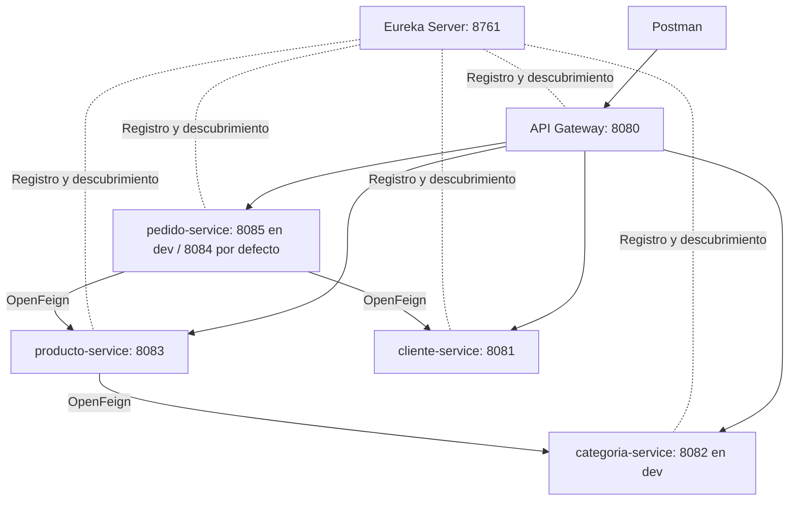

# Laboratorio 13: Service Discovery y API Gateway

## 1. Información general

| Dato | Información |
|---|---|
| Curso | Desarrollo de Aplicaciones Web Avanzado |
| Institución | Tecsup |
| Estudiante | Michael Fernandez |
| Laboratorio | 13 |
| Tema | Service Discovery y API Gateway |

## 2. Objetivo del laboratorio

Implementar un API Gateway con Spring Cloud Gateway y Eureka Server para centralizar el acceso a los microservicios. Las solicitudes ingresan por el puerto **8080** y se dirigen al servicio correspondiente utilizando su nombre registrado en Eureka, en lugar de configurar su dirección física en cada ruta.

El laboratorio reutiliza la comunicación mediante OpenFeign desarrollada en el Laboratorio 12 e incorpora el Gateway como punto de entrada común.

## 3. Tecnologías utilizadas

Las versiones indicadas a continuación corresponden a las declaraciones de los archivos `pom.xml` y del contenedor de Maven incluido en cada proyecto; no representan una comprobación nueva de compilación o de ejecución.

| Tecnología | Versión o configuración encontrada | Uso en el laboratorio |
|---|---|---|
| Java | `25` en categoría, cliente, pedido y producto; `17` en Eureka y Gateway | Lenguaje y nivel de compilación declarado por cada proyecto. |
| Spring Boot | `4.1.2` en los seis proyectos | Arranque y configuración de las aplicaciones. |
| Spring Cloud | Conjunto de dependencias `2025.1.4` en los seis proyectos | Gestión de versiones de los componentes de infraestructura. |
| Spring Cloud Gateway | `spring-cloud-starter-gateway-server-webflux`, gestionado por Spring Cloud | Enrutamiento de solicitudes mediante una implementación reactiva. |
| Eureka Server | `spring-cloud-starter-netflix-eureka-server`, gestionado por Spring Cloud | Registro central de servicios. |
| Eureka Discovery Client | `spring-cloud-starter-netflix-eureka-client`, gestionado por Spring Cloud | Registro y descubrimiento desde los microservicios y el Gateway. |
| Spring Cloud LoadBalancer | Dependencia explícita `spring-cloud-starter-loadbalancer` en el Gateway | Resolución de las rutas `lb://` hacia las instancias descubiertas. |
| OpenFeign | `spring-cloud-starter-openfeign` en pedido y producto, gestionado por Spring Cloud | Consultas HTTP entre microservicios mediante interfaces Java. |
| Maven | Distribución `3.10.0` declarada en `.mvn/wrapper/maven-wrapper.properties`; contenedor `3.3.4` | Gestión de dependencias y construcción de cada proyecto independiente. |
| Spring Data JPA | Dependencia gestionada por Spring Boot | Persistencia de los servicios de negocio. |
| MySQL | Conector `com.mysql:mysql-connector-j`, sin versión explícita; servidor sin versión indicada | Almacenamiento de categorías, clientes, productos y pedidos. |
| Postman | Versión no indicada en el proyecto | Pruebas de las rutas expuestas por el Gateway. |

No se asignan versiones individuales a las bibliotecas administradas por Spring Boot o Spring Cloud porque los archivos del proyecto no las fijan explícitamente.

## 4. Arquitectura del sistema

Postman envía las solicitudes al API Gateway. Este consulta el registro de Eureka y utiliza Spring Cloud LoadBalancer para localizar una instancia del microservicio asociado a cada ruta.



Eureka participa en el registro y descubrimiento; no actúa como intermediario de las peticiones de negocio. `pedido-service` consulta a `cliente-service` y `producto-service` mediante OpenFeign. Además, `producto-service` consulta a `categoria-service` al obtener un producto por identificador o guardar un producto.

**Diferencia importante respecto al esquema inicial:** el archivo `pedido-service/src/main/resources/application.yml` define el puerto **8084**, pero `application-dev.yml` lo reemplaza por **8085**. Las instrucciones de ejecución de este README utilizan `dev` en los servicios de negocio, por lo que pedidos escucha en **8085**. La URL pública continúa siendo `http://localhost:8080/api/pedidos/2`, ya que el Gateway localiza el servicio por su nombre.

## 5. Estructura del proyecto

```text
fernandez_lab13/
├── README.md
├── categoria-service/
├── cliente-service/
├── eureka-server/
├── gateway-service/
├── pedido-service/
└── producto-service/
```

| Carpeta | Función |
|---|---|
| `categoria-service` | Administración de categorías y exposición de `/api/categorias`. |
| `cliente-service` | Administración de clientes y exposición de `/api/clientes`. |
| `eureka-server` | Servidor de registro y descubrimiento de servicios. |
| `gateway-service` | Entrada centralizada y enrutamiento de las cuatro API de negocio. |
| `pedido-service` | Administración de pedidos y composición de respuestas con datos de cliente y producto. |
| `producto-service` | Administración de productos y consulta de su categoría mediante OpenFeign. |

Cada carpeta de servicio contiene su propio `pom.xml`, código fuente, configuración y contenedor de Maven. No existe un `pom.xml` agregador en la raíz del laboratorio.

## 6. Implementación de Eureka Server

Eureka mantiene un registro de las instancias que los clientes pueden descubrir por nombre. La clase `EurekaServerApplication`, en el paquete `com.tecsup.eureka`, utiliza `@SpringBootApplication` y `@EnableEurekaServer`.

La configuración real de `eureka-server/src/main/resources/application.yaml` es:

```yaml
server:
  port: 8761

spring:
  application:
    name: eureka-server

eureka:
  client:
    register-with-eureka: false
    fetch-registry: false
```

El servidor no se registra como cliente de sí mismo ni descarga otro registro. Los servicios de negocio incluyen `@EnableDiscoveryClient`; el Gateway también incorpora esta anotación. Sus configuraciones de registro apuntan a `http://localhost:8761/eureka/`.

En los servicios de negocio, la configuración explícita de Eureka está en sus archivos `application-dev.yml`. Por ejemplo, en categoría figura:

```yaml
eureka:
  client:
    register-with-eureka: true
    fetch-registry: true
    service-url:
      defaultZone: http://localhost:8761/eureka/
```

Para verificar la disponibilidad, abrir **http://localhost:8761/** y comprobar que `categoria-service`, `producto-service`, `cliente-service`, `pedido-service` y `gateway-service` aparezcan registrados con estado **UP**. Los clientes renuevan periódicamente su registro; la actualización del panel puede no ser inmediata.

## 7. Implementación de API Gateway

`gateway-service` es una aplicación Spring Boot independiente cuya clase principal es `com.tecsup.GatewayServiceApplication`. Escucha en el puerto **8080** y utiliza estas dependencias declaradas en su `pom.xml`:

- `spring-cloud-starter-gateway-server-webflux`: servidor Gateway reactivo.
- `spring-cloud-starter-netflix-eureka-client`: registro y consulta de servicios en Eureka.
- `spring-cloud-starter-loadbalancer`: selección de instancias para los destinos `lb://`.
- `spring-boot-starter-actuator`: herramientas de observación; su inclusión no implica que todos sus puntos de acceso estén expuestos.
- `spring-boot-starter-test` y `reactor-test`: soporte para pruebas.

En `gateway-service/src/main/resources/application.yaml` se habilita el localizador de descubrimiento y la conversión de identificadores a minúsculas. También se definen cuatro rutas explícitas, que se muestran en la siguiente sección.

El Gateway se registra en Eureka con esta configuración existente:

```yaml
eureka:
  client:
    register-with-eureka: true
    fetch-registry: true
    service-url:
      defaultZone: http://localhost:8761/eureka/
```

LoadBalancer permite que las rutas utilicen nombres lógicos en vez de puertos fijos. La configuración permite seleccionar entre instancias descubiertas, pero el proyecto no aporta una prueba de distribución de carga entre varias instancias.

## 8. Configuración de rutas

| Servicio | Método | URL a través del Gateway | Destino lógico |
|---|---|---|---|
| Categoría | `GET` | `http://localhost:8080/api/categorias` | `lb://categoria-service` |
| Producto | `GET` | `http://localhost:8080/api/productos` | `lb://producto-service` |
| Cliente | `GET` | `http://localhost:8080/api/clientes` | `lb://cliente-service` |
| Pedido | `GET` | `http://localhost:8080/api/pedidos/2` | `lb://pedido-service` |

El siguiente fragmento corresponde a la configuración existente de `gateway-service/src/main/resources/application.yaml`:

```yaml
server:
  port: 8080

spring:
  application:
    name: gateway-service

  cloud:
    gateway:
      server:
        webflux:
          discovery:
            locator:
              enabled: true
              lower-case-service-id: true

          routes:
            # CATEGORIA-SERVICE
            - id: categoria-service
              uri: lb://categoria-service
              predicates:
                - Path=/api/categorias/**

            # PRODUCTO-SERVICE
            - id: producto-service
              uri: lb://producto-service
              predicates:
                - Path=/api/productos/**

            # CLIENTE-SERVICE
            - id: cliente-service
              uri: lb://cliente-service
              predicates:
                - Path=/api/clientes/**

            # PEDIDO-SERVICE
            - id: pedido-service
              uri: lb://pedido-service
              predicates:
                - Path=/api/pedidos/**
```

Cada predicado `Path` identifica las solicitudes que pertenecen a un servicio. El prefijo `lb://` indica que el destino se obtiene a través del descubrimiento de servicios y LoadBalancer. Estas rutas no declaran filtros para quitar o reescribir el prefijo: los controladores ya utilizan `/api/categorias`, `/api/productos`, `/api/clientes` y `/api/pedidos`.

## 9. Comunicación mediante OpenFeign

La comunicación implementada en el Laboratorio 12 se reutiliza en el Laboratorio 13. `PedidoServiceApplication` incluye `@EnableFeignClients`, y `pedido-service` declara estas interfaces:

| Interfaz | Servicio indicado en `@FeignClient` | Consulta |
|---|---|---|
| `ClienteClient` | `cliente-service` | `GET /api/clientes/{id}` |
| `ProductoClient` | `producto-service` | `GET /api/productos/{id}` |

`PedidoService` utiliza ambas interfaces para consultar los datos remotos y construir `PedidoRespuestaDTO`, que incluye el identificador, la cantidad, el estado, el cliente y el producto. La implementación actual requiere que el pedido consultado tenga exactamente un detalle; en caso contrario devuelve un conflicto HTTP `409`.

Las interfaces identifican a los servicios por nombre y no declaran una URL fija. Estas llamadas son internas entre microservicios: no necesitan pasar por el Gateway. En `producto-service` también existen `@EnableFeignClients` y `CategoriaClient`, con destino `categoria-service` y consulta `GET /api/categorias/{id}`.

## 10. Ejecución del proyecto

### Preparación en IntelliJ IDEA

1. Abrir o importar como proyecto Maven cada una de las seis carpetas y permitir la carga de sus dependencias.
2. Revisar el SDK y el nivel de compilación de cada módulo según su `pom.xml`: los cuatro servicios de negocio declaran Java **25**, mientras que Eureka y Gateway declaran Java **17**. Estos son los valores del proyecto, no una certificación de compatibilidad de todas las dependencias con cada JDK.
3. Iniciar MySQL y disponer de las bases de datos indicadas por el perfil seleccionado. La configuración de desarrollo utiliza `localhost:3306` y las bases `bd_categoria_dev`, `bd_producto_dev`, `bd_cliente_dev` y `bd_pedido_dev`.
4. Verificar que el entorno local permita las conexiones a MySQL. No publicar credenciales personales ni incorporar secretos al repositorio. La opción existente `ddl-auto: update` actualiza las tablas, pero no garantiza la creación de las bases de datos ni la existencia de datos de prueba.
5. Para esta ejecución, seleccionar el perfil existente **`dev`** en la configuración de ejecución de los cuatro servicios de negocio. Categoría ya lo activa desde su `application.yml`; cliente, producto y pedido no lo activan automáticamente en sus archivos base. En IntelliJ IDEA puede indicarse en **Perfiles activos** de la configuración Spring Boot o mediante la variable de entorno `SPRING_PROFILES_ACTIVE=dev` de esa ejecución. No se requiere editar los YAML.

### Orden recomendado de inicio

Ejecutar el método `main` de cada clase desde IntelliJ IDEA, usando la opción **Ejecutar**, en este orden:

| Orden | Componente | Clase principal | Puerto en la ejecución descrita |
|---|---|---|---|
| 1 | MySQL | Servicio de base de datos, fuera de Spring Boot | `3306` |
| 2 | Eureka Server | `com.tecsup.eureka.EurekaServerApplication` | `8761` |
| 3 | `categoria-service` | `com.tecsup.CategoriaServiceApplication` | `8082` con `dev` |
| 4 | `producto-service` | `com.tecsup.ProductoServiceApplication` | `8083` con `dev` |
| 5 | `cliente-service` | `com.tecsup.ClienteServiceApplication` | `8081` con `dev` |
| 6 | `pedido-service` | `com.tecsup.PedidoServiceApplication` | `8085` con `dev` |
| 7 | `gateway-service` | `com.tecsup.GatewayServiceApplication` | `8080` |

Esperar a que Eureka esté disponible antes de iniciar sus clientes. Antes de probar las rutas, revisar los mensajes de arranque y el registro de las cinco aplicaciones cliente en su panel.

**Otros valores existentes:** pedidos utiliza `8084` y `bd_pedido` sin el perfil `dev`; cliente y producto utilizan `bd_cliente` y `bd_producto` en sus archivos base. Categoría también contiene un perfil `prod` con puerto `9092`, que no se utiliza en el procedimiento local descrito. No debe confundirse con el puerto `8082` del perfil `dev`.

## 11. Pruebas realizadas en Postman

Las siguientes pruebas fueron realizadas correctamente por el estudiante y se documentan a partir de los resultados proporcionados. No se presentan como una nueva ejecución automatizada durante la preparación de este README.

| Prueba | Solicitud | Resultado informado |
|---|---|---|
| Listar categorías | `GET http://localhost:8080/api/categorias` | `200 OK` |
| Listar productos | `GET http://localhost:8080/api/productos` | `200 OK` |
| Listar clientes | `GET http://localhost:8080/api/clientes` | `200 OK` |
| Consultar pedido | `GET http://localhost:8080/api/pedidos/2` | `200 OK` |

En la consulta del pedido se obtuvieron estos datos:

| Dato | Valor informado |
|---|---|
| Pedido ID | `2` |
| Cantidad | `2` |
| Estado | `ANULADO` |
| Cliente | Michael Fernandez |
| Producto | Laptop |
| Precio | `2500.0` |

Las cuatro respuestas satisfactorias muestran que el Gateway redirigió las solicitudes a las API de negocio utilizando una única dirección de entrada. La respuesta del pedido también muestra la integración de información de cliente y producto mediante OpenFeign.

Para repetir la consulta es necesario que el pedido `2` y sus datos relacionados existan en la base de datos utilizada. El repositorio no garantiza la carga automática de esos registros; las pruebas informadas no demuestran por sí solas tolerancia a fallos ni balanceo entre múltiples instancias.

## 12. Resultados obtenidos

Como resultado del laboratorio se incorporó `gateway-service` con registro en Eureka y rutas para los cuatro microservicios de negocio. La configuración revisada permite registrar y descubrir los servicios, y su disponibilidad puede comprobarse en el panel de Eureka.

De acuerdo con las pruebas satisfactorias informadas:

- Las rutas de categorías, productos, clientes y pedidos respondieron con `200 OK` a través del Gateway.
- El acceso quedó centralizado en el puerto **8080**, sin que Postman necesitara utilizar el puerto de cada servicio.
- Los microservicios de destino estuvieron disponibles para atender las consultas.
- La consulta del pedido integró los datos del cliente y del producto mediante OpenFeign.

El estado **UP** y el registro del Gateway deben verificarse en el panel de Eureka en cada ejecución; este documento no sustituye esa comprobación en tiempo real.

## 13. Conclusiones

1. Aprendí que un API Gateway facilita el acceso al sistema porque puedo consultar diferentes microservicios desde una sola dirección, sin recordar el puerto de cada uno.
2. Comprendí que Eureka Server funciona como un registro de servicios y que revisar su panel ayuda a identificar cuáles aplicaciones están disponibles antes de realizar las consultas.
3. Al configurar las rutas entendí la relación entre la dirección solicitada y el nombre del servicio. También comprobé por qué es importante revisar el perfil activo: un mismo servicio puede utilizar puertos distintos.
4. Las pruebas en Postman me permitieron comprobar que las solicitudes llegaban al destino esperado. Consultar el pedido con sus datos relacionados fue una forma práctica de revisar la integración completa.
5. Este laboratorio me ayudó a diferenciar la responsabilidad de cada componente: el Gateway recibe las solicitudes externas, Eureka permite encontrar servicios y OpenFeign facilita la comunicación entre ellos. Mantener los proyectos separados hace más clara esa organización.
