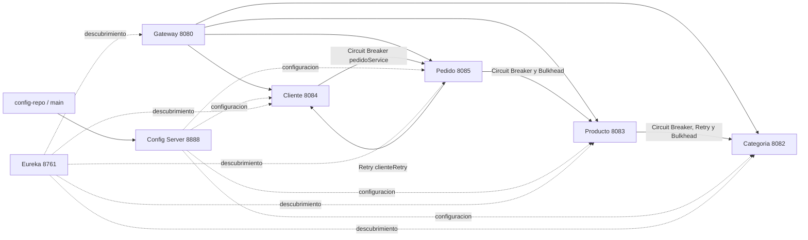
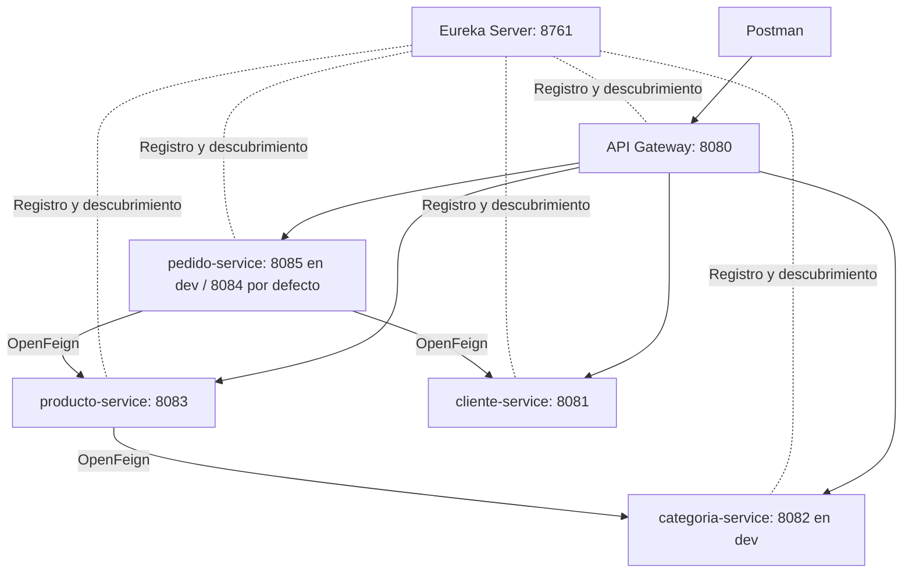

# Laboratorio 14: Config Server y Resiliencia

**Tecsup — Desarrollo de Aplicaciones Web Avanzado — Michael Fernandez**

## 1. Descripción y objetivos

Este laboratorio continúa los microservicios existentes; no los recrea. Centraliza su configuración con Spring Cloud Config y añade tolerancia a fallos mediante Circuit Breaker, Retry y Bulkhead con Resilience4j.

Objetivos:

1. Consultar configuración centralizada por aplicación y perfil.
2. Mantener descubrimiento con Eureka y comunicación OpenFeign.
3. Evitar fallos en cascada y recuperar las consultas después de una interrupción.
4. Demostrar reintentos reales y límites de concurrencia con llamadas HTTP.
5. Conservar los contratos anteriores y las validaciones de creación de pedidos.

La guía revisada es `GLAB-S14-RCOELLO-2026-01.pdf`, páginas 3–25. Se conserva al final la documentación heredada del laboratorio anterior como referencia, **no como descripción de los puertos actuales**.

## 2. Tecnologías y compatibilidad

| Componente | Versión del proyecto |
|---|---|
| Spring Boot | 4.1.2 |
| Spring Cloud BOM | 2025.1.4 |
| Java declarado | 25 en servicios de negocio; 17 en Config Server, Eureka y Gateway |
| JVM encontrada y usada en esta revisión | OpenJDK 27.0.1.0.2 |
| Resilience4j starter | `resilience4j-spring-boot4:2.4.0` |
| OpenFeign, Eureka, Config, Gateway | Versiones gestionadas por el BOM existente |
| Persistencia | Spring Data JPA, MySQL |
| Observabilidad | Spring Boot Actuator |
| Construcción y verificación | Maven 3.9.16 instalado; wrappers existentes conservados; PowerShell; Postman CLI 1.76.0 |

No se cambiaron versiones. Compilar con el JDK 17 del PATH no permite `release 25`; se seleccionó el JDK ya instalado que ejecutaba los servicios. El procesador Lombok se declaró explícitamente en `producto-service/pom.xml`: desde JDK 23 no basta con tenerlo en el classpath. La resolución Maven y las pruebas locales son evidencia de esta combinación concreta, no una certificación de todas las combinaciones de JDK ni una matriz oficial de soporte.

La clase `CompatibilityVerifierProperties` de `spring-cloud-commons:5.0.4`, efectivamente resuelta por el proyecto, declara como compatibles las líneas Boot **4.0.x y 4.1.x** (inspeccionada con `javap`). El starter Resilience4j 2.4.0 resuelve módulos comunes/Spring6 2.3.0 en este árbol de dependencias: se mantuvo esa gestión existente y se verificaron los contextos, en vez de actualizar componentes automáticamente.

## 3. Arquitectura, puertos y bases de datos



| Servicio | Puerto DEV | Base DEV |
|---|---|---|
| config-server | 8888 | No utiliza |
| eureka-server | 8761 | No utiliza |
| gateway-service | 8080 | No utiliza |
| categoria-service | 8082 | bd_categoria_dev |
| producto-service | 8083 | bd_producto_dev |
| cliente-service | 8084 | bd_cliente_dev |
| pedido-service | 8085 | bd_pedido_dev |

Eureka no transporta las consultas de negocio. Feign resuelve los nombres registrados y realiza HTTP directamente. La consulta Cliente → Pedido vuelve a consultar **el cliente por ID**, no `/clientes/pedidos/{id}`: no introduce recursión HTTP.

## 4. Estructura

```text
fernandez_lab14/
├── README.md
├── .gitignore
├── config-server/
├── eureka-server/
├── gateway-service/
├── categoria-service/
├── producto-service/
├── cliente-service/
├── pedido-service/
├── scripts/
│   ├── Servicios-Lab.ps1
│   ├── Probar-Resiliencia.ps1
│   ├── Probar-Circuitos-Existentes.ps1
│   ├── Probar-Validaciones.ps1
│   ├── Capturar-Evidencia.ps1
│   ├── Finalizar-Pruebas.ps1
│   ├── Generar-Informe.py
│   └── postman-pedido.js
└── evidencias/
    ├── config-server/
    ├── perfiles/
    ├── circuit-breaker/
    ├── retry/
    ├── bulkhead/
    └── actividad-final/
```

Cada servicio mantiene su propio proyecto Maven. `.runtime/` contiene únicamente datos operativos locales excluidos de Git: argumentos de arranque, inventario de procesos y logs completos.

## 5. Config Server y perfiles

`config-server` usa `@EnableConfigServer`, puerto 8888 y la rama `main` del repositorio independiente [config-repo](https://github.com/mfernandezc-dev/config-repo). No se creó otro repositorio ni se publicaron cambios.

Los clientes importan `optional:configserver:http://localhost:8888`. Los archivos generales `<servicio>.yml` aportan propiedades comunes y `<servicio>-dev.yml` / `<servicio>-prod.yml` aportan las específicas del entorno. `default` no equivale a `dev`.

Ejemplos: `GET http://localhost:8888/producto-service/default`, `/producto-service/dev` y `/producto-service/prod`. Repetir para los cuatro servicios. La consulta del perfil PROD **solo lee configuración**: no demuestra una conexión a una base productiva ni un despliegue PROD.

Se retiraron duplicados de puerto/datasource/JPA de los YAML locales de categoría y producto, conservando los archivos y las propiedades locales de ambiente/Eureka. Los circuitos existentes siguen centralizados en config-repo. Retry, Bulkhead, orden de aspectos y timeouts se declaran en los consumidores locales, como permite la guía. No se duplican los cuatro parámetros del circuito en ambos repositorios. La exposición de Actuator y los timeouts demostrativos están limitados al perfil DEV.

Las contraseñas no deben publicarse. Para un entorno con credenciales reales, utilizar variables de entorno (`SPRING_DATASOURCE_USERNAME`, `SPRING_DATASOURCE_PASSWORD`) o configuración externa no versionada; no colocar valores reales en capturas ni en URLs de Git.

## 6. Circuit Breaker

El circuito acumula fallos; al superar el umbral pasa de `CLOSED` a `OPEN` y rechaza llamadas sin intentar HTTP. Después de la espera permite llamadas de prueba (`HALF_OPEN`) para recuperar `CLOSED`.

| Consumidor | Dependencia | Instancia |
|---|---|---|
| producto-service | categoria-service | categoriaService |
| pedido-service | producto-service | productoService |
| cliente-service | pedido-service | pedidoService |

Se conservan `slidingWindowSize: 5`, `minimumNumberOfCalls: 3`, `failureRateThreshold: 50`, `waitDurationInOpenState: 10s`, obtenidos de Config Server. El fallback proporciona datos explícitamente no disponibles; **no valida la existencia de un cliente/producto al crear un pedido**.

Un HTTP 200 no basta para afirmar éxito funcional: la respuesta puede contener un fallback anidado. Las pruebas comprueban valores reales y estados del circuito en `/actuator/circuitbreakers`.

## 7. Retry y composición de aspectos

Retry repite una operación que falla de forma transitoria. `maxAttempts: 3` significa **un intento inicial y dos reintentos**, no cuatro llamadas. `waitDuration: 2s` aplica entre intentos.

- `CategoriaCircuitService.obtenerCategoria`: `@Retry(name="categoriaRetry")` conserva `@CircuitBreaker` y añade Bulkhead.
- `ClienteRetryService.obtenerCliente`: `@Retry(name="clienteRetry", fallbackMethod="clienteFallback")` se utiliza en la composición de respuestas de pedidos.
- Se reintentan errores de conexión/timeout y HTTP 500, 502, 503, 504. No se reintenta un 404 ni un rechazo por saturación del Bulkhead.

Con ambos patrones, el circuito cuenta solicitudes lógicas, no cada intento de Retry: una consulta fallida a Categoría puede producir tres HTTP y contar como **un fallo** del circuito. Para llegar a OPEN se necesitan las llamadas lógicas requeridas por su ventana. Esto evita abrirlo durante el primer ciclo de reintentos.

En Producto, el orden es **CircuitBreaker(Bulkhead(Retry(Feign)))**: Circuit Breaker con orden 1; Bulkhead con orden fijo 2147483646 en esta dependencia; Retry con orden 2147483647. La clase de propiedades de Bulkhead no expone setter para cambiar su orden; no se configura una propiedad incompatible. Solo el circuito exterior ejecuta el fallback final. Un fallback interior devolvería una respuesta normal, impediría a Retry detectar el fallo y podría registrar éxitos falsos en el circuito. Este diseño cuenta una operación lógica fallida después de agotar sus intentos. Las excepciones de Bulkhead lleno y recurso inexistente se excluyen del cálculo de fallos del circuito.

Para Cliente, Pedido tiene un timeout de lectura DEV de **2000 ms**, inferior a los **5000 ms** simulados. Sin timeout o error, una respuesta lenta pero exitosa no se reintenta. El cliente HTTP puede abandonar la espera mientras el servidor termina de procesar; por ello Retry debe reservarse para operaciones idempotentes, como estas consultas GET.

## 8. Bulkhead y simulación reversible

Bulkhead limita recursos simultáneos: `maxConcurrentCalls: 2`, `maxWaitDuration: 1s`. Las dos primeras consultas ocupan permisos; otras esperan como máximo un segundo y, si no hay permiso, reciben fallback. Se aplica en Producto → Categoría (`categoriaBulkhead`) y Pedido → Producto (`productoBulkhead`). No es un límite distribuido entre varias instancias del consumidor.

La lentitud está aislada en filtros y un interceptor Feign con `@Profile("lab")`. No altera entidades ni datos, y no se activa con DEV solamente. Requiere **DEV + LAB y una cabecera explícita**:

| Solicitud al consumidor | Cabecera | Dependencia que demora |
|---|---|---|
| `GET :8083/api/productos/1` | `X-Lab-Categoria-Delay-Ms: 10000` | Categoría, diez segundos |
| `GET :8085/api/pedidos?detallado=true` | `X-Lab-Cliente-Delay-Ms: 5000` | Cliente, cinco segundos |
| `GET :8085/api/pedidos?detallado=true` | `X-Lab-Producto-Delay-Ms: 10000` | Producto, diez segundos |

Se aceptan de 0 a 10000 ms únicamente en las consultas GET por ID. Sin la cabecera no hay demora. Para desactivar por completo la capacidad de simulación, arrancar solo con perfil `dev`. Los timeouts hacia categoría/producto son 15000 ms para permitir completar las dos respuestas lentas admitidas.

### Diferencias y usos

| Patrón | Problema | Acción | Uso apropiado |
|---|---|---|---|
| Retry | Fallo transitorio | Repetir secuencialmente con espera | GET idempotente con interrupción breve |
| Bulkhead | Saturación/concurrencia | Limitar admisiones simultáneas | Dependencia lenta que ocupa hilos y conexiones |
| Circuit Breaker | Fallo sostenido | Interrumpir temporalmente las llamadas | Dependencia caída con muchos consumidores |

Retry puede aumentar la carga; Bulkhead la contiene. No son sustitutos y deben coordinarse con los timeouts y el circuito.

## 9. Ejecución y endpoints

Orden: **MySQL → Config Server → Eureka → Categoría → Producto → Cliente → Pedido → Gateway**. Esperar disponibilidad y registro antes de probar. No iniciar dos instancias en el mismo puerto. Los cuatro servicios de negocio activan DEV en sus YAML base.

Desde cada carpeta, con un JDK que soporte el nivel declarado:

```powershell
.\mvnw.cmd -B -ntp -DskipTests package
.\mvnw.cmd spring-boot:run "-Dspring-boot.run.arguments=--spring.profiles.active=dev --spring.jpa.hibernate.ddl-auto=validate"
```

Para simulación, cambiar el argumento a `--spring.profiles.active=dev,lab` en los servicios participantes. `validate` requiere tablas existentes, no crea ni modifica su esquema. No ejecutar DDL ni cargar datos automáticamente sobre bases existentes.

| Método | Endpoint | Uso |
|---|---|---|
| GET | `:8082/api/categorias/1` | Categoría real |
| GET | `:8083/api/productos` y `/api/productos/1` | Producto con categoría resiliente |
| GET | `:8084/api/clientes/1` | Cliente |
| GET | `:8084/api/clientes/pedidos/1` | Cliente consume pedido mediante Feign |
| GET | `:8085/api/pedidos` | Listado original, sin romper contrato |
| GET | `:8085/api/pedidos?detallado=true` | Listado compuesto con Retry/Bulkhead |
| GET | `:8085/api/pedidos/1` | Pedido compuesto original |
| POST | `:8085/api/pedidos` | Crear; valida cliente y producto sin fallback |
| PUT | `:8085/api/pedidos/{id}/estado` | Cambiar estado existente |
| GET | `:8080/api/...` | Rutas conservadas del Gateway |

La opción `detallado=true` mantiene el método y esquema del listado original sin parámetros. La composición conserva la restricción previa de exactamente un detalle por pedido (409 si no se cumple); no se alteraron registros para acomodar la prueba.

## 10. Pruebas y evidencias

El diagnóstico inicial real está en [`evidencias/circuit-breaker/diagnostico-fase1.md`](evidencias/circuit-breaker/diagnostico-fase1.md). Config Server respondió para los doce pares aplicación/perfil; se guardaron respuestas sanitizadas en [`evidencias/perfiles/configuracion-consultada.json`](evidencias/perfiles/configuracion-consultada.json).

El recorrido reproducible está en `scripts/Probar-Resiliencia.ps1`. Solo usa GET en los endpoints de negocio. Identifica y detiene únicamente procesos del laboratorio mediante `Servicios-Lab.ps1`; el inventario local evita matar aplicaciones ajenas. La concurrencia usa cuatro tareas HTTP reales, no pestañas serializadas del navegador. La salida se guarda junto con respuestas, tiempos, estados y extractos auténticos de consola. Los resultados finales se resumen en [evidencias/RESULTADOS.md](evidencias/RESULTADOS.md).

Resultados del recorrido inicial (se conservan sus tiempos; la sesión posterior con capturas directas se detalla debajo):

| Verificación | Resultado |
|---|---|
| Maven: siete módulos | Compilación correcta; **11 pruebas aprobadas** |
| Config Server | Doce consultas de aplicación/perfil con las fuentes esperadas |
| Cliente → Pedido | Caída real, fallback, OPEN y recuperación a CLOSED |
| Producto → Categoría y Pedido → Producto | Regresión con caída real, OPEN y recuperación estable a CLOSED |
| Retry Categoría | Tres intentos, 4340 ms y fallback; recuperación posterior |
| Retry Cliente | Tres intentos por timeout, 10079 ms y fallback; recuperación posterior |
| Bulkhead Categoría | Dos respuestas reales ~10 s y dos fallbacks ~1 s |
| Bulkhead Producto | Dos respuestas reales ~10 s y dos fallbacks ~1 s |
| Validaciones HTTP | Dos referencias inexistentes rechazadas con 404; listado intacto |
| Postman final | Tres solicitudes, **12 aserciones aprobadas** |
| Simulación al terminar | Perfil LAB desactivado; las cabeceras de demora ya no producen esperas |

Ver el [informe visual de respuestas registradas](evidencias/informe.html) y el [inventario de archivos creados/modificados](evidencias/CAMBIOS.md). Las capturas del informe se identifican expresamente como informe, no como una interfaz de Postman.

### Índice de evidencias

| Actividad | Capturas o documentos | Resultados fuente |
|---|---|---|
| Config Server | [Respuesta real, perfil default](evidencias/config-server/categoria-default.png) | [Doce consultas de configuración](evidencias/perfiles/configuracion-consultada.json) |
| Perfiles DEV y PROD | [Alcance de la consulta de perfiles](evidencias/perfiles/README.md) | [Respuestas sanitizadas](evidencias/perfiles/configuracion-consultada.json); consultar PROD no demuestra despliegue |
| Eureka | [Registro real y aviso de autopreservación](evidencias/config-server/eureka-registro.png) | [Instancias registradas](evidencias/config-server/eureka-instancias.json) |
| Circuit Breaker Cliente → Pedido | [Antes](evidencias/circuit-breaker/antes-real.png), [OPEN](evidencias/circuit-breaker/open-real.png), [CLOSED](evidencias/circuit-breaker/recuperacion-real.png) | [Respuesta normal](evidencias/circuit-breaker/antes.json), [fallback](evidencias/circuit-breaker/pedido-detenido.json), [recuperación](evidencias/circuit-breaker/recuperacion.json) |
| Circuit Breaker Producto → Categoría | [Explicación de la regresión](evidencias/RESULTADOS.md) | [OPEN y fallback](evidencias/circuit-breaker/categoria-open.json), [recuperación](evidencias/circuit-breaker/categoria-recuperacion.json) |
| Circuit Breaker Pedido → Producto | [Explicación de la regresión](evidencias/RESULTADOS.md) | [OPEN y fallback](evidencias/circuit-breaker/producto-open.json), [recuperación](evidencias/circuit-breaker/producto-recuperacion.json) |
| Retry Categoría | [Captura del informe, no de ejecución en vivo](evidencias/retry/informe-resultados.png) | [Tres intentos y fallback](evidencias/retry/categoria-no-disponible.json), [dependencia recuperada](evidencias/retry/categoria-disponible.json) |
| Bulkhead Categoría | [Informe de resultados registrados](evidencias/informe.html) | [Cuatro solicitudes concurrentes](evidencias/bulkhead/categoria-concurrente.json) |
| Actividad final: Retry Cliente | [Captura directa de consola](evidencias/actividad-final/cliente-retry-ejecucion.png) | [Resultados y logs](evidencias/actividad-final/cliente-retry-ejecucion.json), [metadatos y SHA-256](evidencias/actividad-final/cliente-retry-ejecucion.png.json) |
| Actividad final: Bulkhead Producto | [Captura directa de consola](evidencias/actividad-final/producto-bulkhead-ejecucion.png) | [Resultados y logs](evidencias/actividad-final/producto-bulkhead-ejecucion.json), [metadatos y SHA-256](evidencias/actividad-final/producto-bulkhead-ejecucion.png.json) |
| Maven y Postman | [Interpretación y límites](evidencias/RESULTADOS.md) | [Once pruebas Maven](evidencias/actividad-final/maven-tests.json), [doce aserciones Postman](evidencias/actividad-final/postman-verificacion-final.json) |
| Cierre de la sesión de capturas | [DEV restaurado, LAB desactivado y datos conservados](evidencias/actividad-final/estado-final-capturas-20261121-190923.json) | [Intento previo interrumpido; no es un cierre satisfactorio](evidencias/actividad-final/estado-final-capturas-20261121-190620.json) |

### Actividad final: capturas directas de ejecución

El **21/11/2026, entre las 19:07 y 19:09 (-05:00)**, se ejecutó una sesión posterior contra los servicios Java y MySQL reales, sin modificar su implementación. Ambas capturas muestran una consola nativa de Windows que ejecutó las solicitudes HTTP y presentó URL, cabecera, respuestas, tiempos y extractos originales de logs de esa misma ejecución; **no son pantallas de Postman ni imágenes del informe HTML**. Sus metadatos identifican la fuente y el hash de cada PNG.

| Escenario sobre `GET http://localhost:8085/api/pedidos?detallado=true` | Resultado registrado |
|---|---|
| Retry Cliente, `X-Lab-Cliente-Delay-Ms: 5000` | Tres intentos por timeout, demora de 5000 ms registrada en Cliente, fallback de Cliente y Producto normal; HTTP 200 en **10114 ms**; seis comprobaciones aprobadas. |
| Bulkhead Producto, `X-Lab-Producto-Delay-Ms: 10000` | Cuatro GET realmente concurrentes: dos productos reales en **10146/10141 ms**, dos fallbacks en **1139/1142 ms**; máximo de dos llamadas activas y cuatro HTTP 200; siete comprobaciones aprobadas. |

**Trece comprobaciones aprobaron entre ambos escenarios**, separadas de las doce aserciones Postman del recorrido anterior. Un HTTP 200 con fallback significa que el consumidor produjo una respuesta degradada: **no demuestra que la dependencia respondiera correctamente**. En Bulkhead, los dos rechazos se identifican además por `productoBulkhead is full` en consola.

El cierre registrado dejó los cuatro servicios de negocio en **DEV, sin LAB, con `ddl-auto=validate`**. Las cabeceras artificiales fueron ignoradas en las verificaciones directas posteriores (23/37/25 ms para Categoría/Producto/Cliente), y el pedido sin cabeceras devolvió datos reales. Los listados consultados antes/después permanecieron iguales. Este es el estado observado al cerrar aquella sesión, no una comprobación en vivo de cada lectura del README; no se realizó despliegue PROD.

Las capturas de navegador/consola documentan ejecución; `retry/informe-resultados.png` captura un **informe derivado**; los JSON guardan resultados; el Mermaid de la sección 3 es un **diagrama explicativo**, no una prueba. Las envolturas `value`/`Count` de algunos JSON anteriores son serialización de PowerShell, no el contrato HTTP original.

### Repetición controlada

Para reutilizar el controlador de procesos, primero ejecutar los cuatro servicios normalmente desde IntelliJ y capturar su classpath una sola vez:

```powershell
.\scripts\Servicios-Lab.ps1 -Accion Capturar
.\scripts\Servicios-Lab.ps1 -Accion Reiniciar -Servicio categoria-service -Simulacion
# Repetir Reiniciar para producto-service, cliente-service y pedido-service.
.\scripts\Probar-Resiliencia.ps1
```

El inventario existente no se sobrescribe. Es una ayuda específica de la sesión local; Maven y las clases principales siguen siendo el mecanismo normal de arranque. No versionar `.runtime`.

Al terminar una repetición, reiniciar los cuatro servicios sin `-Simulacion` (o retirar `lab` de los perfiles activos en IntelliJ). En esta sesión ya quedaron todos en DEV únicamente. `Finalizar-Pruebas.ps1` automatiza el cierre con capturas, pero las capturas existentes no se sobrescriben: para repetir esa parte se deben elegir nombres nuevos, conservando la evidencia anterior.

Las pruebas de validación `PedidoServiceValidationTests` usan repositorio y clientes simulados **solo para verificar que no se guarda si falla la validación**. Las pruebas HTTP de resiliencia son separadas y utilizan servicios reales y MySQL existente. No se presentan pruebas unitarias como evidencia de comunicación real.

`scripts/Probar-Validaciones.ps1` permite comprobar las validaciones por HTTP: primero confirma 404 para las referencias elegidas, luego envía dos pedidos inválidos y compara el listado antes/después. No elimina registros si encuentra una diferencia. Estas solicitudes POST negativas están separadas del recorrido de resiliencia de solo lectura.

Después de un reinicio, que el puerto esté escuchando no garantiza que el consumidor ya haya actualizado Eureka y su caché de LoadBalancer. El script espera datos reales antes de dar por estable la comunicación; no confunde un 503 de descubrimiento transitorio con una prueba concluida.

### Capturas académicas

Si no hay PNG generado, abrir Postman o navegador y capturar la URL completa, estado y JSON; para Retry, incluir las tres líneas de intento de una única solicitud; para Bulkhead, mostrar los cuatro resultados simultáneos con dos respuestas reales y dos fallbacks. Para Circuit Breaker, capturar antes, servicio detenido, estado OPEN y recuperación. Los JSON y logs no se presentan como capturas de pantalla.

Para capturar una página local sin generar imágenes artificiales: `scripts/Capturar-Evidencia.ps1 -Url http://localhost:8084/actuator/circuitbreakers -Archivo circuit-breaker/estado.png`. Usa Chrome headless, guarda origen y hora, y no sobrescribe capturas existentes. Verificar visualmente el PNG antes de utilizarlo como evidencia.

## 11. Errores encontrados y soluciones

1. **Puerto 8085 ocupado:** pertenecía al Pedido Service correcto (PID 15108). No había duplicado activo; el segundo arranque fallido no justifica cerrar procesos ajenos.
2. **HTTP 500 histórico:** no se reprodujo al comenzar; ambas consultas devolvieron 200 con datos reales. Sin la consola histórica no se afirma una causa raíz ni una corrección que no se haya demostrado.
3. **Fallback durante recompilación:** Postman detectó `precio: null` aunque HTTP fue 200. La prueba falló correctamente; se conserva su resultado. Para el recorrido controlado se deshabilitó DevTools en el arranque y se reiniciaron las aplicaciones identificadas.
4. **Lombok/Maven:** habilitación explícita del procesador de anotaciones, conservando la versión gestionada.
5. **Retry y fallback combinados:** fallback solo exterior, excepciones transitorias explícitas y orden de aspectos definido.
6. **Listado de pedidos sin llamadas remotas:** se añadió `detallado=true` sin quitar el listado anterior.
7. **Configuración repetida:** datasource/JPA/puertos locales de categoría/producto se delegan al repositorio central. Se corrigió `desarrollos` por `desarrollo` en el ambiente local de Pedido.
8. **Referencias inexistentes al crear pedidos:** la prueba HTTP negativa encontró un 500 por `FeignException.NotFound` sin manejar, aunque el guardado sí se impedía. Se añadió un manejador que devuelve 404 para referencias ausentes y 503 si no es posible validarlas; no se utiliza fallback para autorizar el guardado. Este hallazgo es un caso reproducible distinto del 500 histórico de la consulta del pedido 1.
9. **Herramientas Windows:** el argfile de Java se cambió a classpath relativo para evitar problemas de codificación con `4° Ciclo`. El lector de logs usa acceso compartido y strings puros para evitar tanto el bloqueo de archivos abiertos como la serialización recursiva de metadatos de PowerShell 5. Estos errores de preparación no se cuentan como fallos del servicio ni como pruebas aprobadas.

## 12. Diferencias técnicas frente a la guía

- La guía mezcla Boot 3.5.15/3.5.3 y Cloud 2025.0.0 con Java 17; se conservan Boot 4.1.2, Cloud 2025.1.4 y niveles 17/25 de estos proyectos.
- Se usa el starter Resilience4j para **Boot 4**, no el de Boot 3; AOP se habilita con el starter AspectJ existente.
- En Boot 4 se conservan `spring-boot-starter-webmvc` y pruebas MVC modulares, en lugar de copiar el POM completo de la guía.
- `retry` y `bulkhead` se configuran bajo **`resilience4j`**, corrigiendo las indentaciones ambiguas de los ejemplos de la guía.
- El orden escrito de anotaciones no define su precedencia AOP. Se configura el orden para evitar que el fallback anule los reintentos.
- No se deja `Thread.sleep` incondicional en los controladores: las demoras son optativas bajo LAB y cabecera.
- Se conserva el esquema HTTP del listado de pedidos y se usa una opción adicional para la composición requerida por la actividad final.
- **Pendiente de validación docente:** el ejemplo de `ProductoService` en la página 17 incluye `actualizar()`, ausente en esta implementación. También debe confirmarse la aceptación de `GET /api/pedidos?detallado=true` para la verificación de la página 25; `GET /api/pedidos` conserva el listado original. Son diferencias académicas documentadas, no funcionalidades implementadas automáticamente.

## 13. Publicación segura, todavía no autorizada

Repositorios independientes: `config-repo` para YAML centrales y [DES_APP_WEB](https://github.com/mfernandezc-dev/DES_APP_WEB) para `fernandez_lab14`. No se hicieron commits, push, ramas ni worktrees. No se modificó `fernandez_lab13`.

**Foto de la auditoría del 21/11/2026, no estado remoto consultado permanentemente:** GitHub tenía cinco commits pendientes respecto al HEAD local `3caec9f` y su `main` estaba en `9967692`; ninguno de esos commits modificaba Lab 14. La referencia local `origin/main` estaba desactualizada. Se identificaron **57 archivos previamente preparados**, de varios laboratorios, y **ningún archivo de `fernandez_lab14/` publicado en el remoto** en ese momento. Estas cifras y referencias deben verificarse nuevamente antes de publicar.

Cuatro de las entradas preparadas pertenecen a Lab 14 y contienen esqueletos incompletos, **no las implementaciones funcionales del directorio de trabajo**:

- `cliente-service/src/main/java/com/tecsup/client/PedidoClient.java`.
- `cliente-service/src/main/java/com/tecsup/service/PedidoCircuitService.java`.
- `pedido-service/src/main/java/com/tecsup/services/ProductoCircuitService.java`.
- `producto-service/src/main/java/com/tecsup/services/CategoriaCircuitService.java`.

El cierre de las capturas confirmó el índice intacto con sus 57 entradas. No se hizo pull automático sobre ese árbol de trabajo. Antes de publicar: revisar diffs, índice y posibles colisiones, acordar cualquier integración del remoto con autorización y preparar **solo** los archivos revisados de este laboratorio, excluyendo target, IDE, archivos temporales y secretos. No ejecutar `git add .` desde la raíz general ni confirmar el índice actual como entrega de Lab 14.

## 14. Cinco conclusiones

1. Config Server separa la configuración del código y permite distinguir DEV de PROD sin duplicar los servicios.
2. Circuit Breaker protege al consumidor de fallos sostenidos, pero el fallback debe distinguirse de los datos reales.
3. Retry necesita fallos observables y límites; una demora exitosa no demuestra reintentos.
4. Bulkhead limita operaciones simultáneas y evita que una dependencia lenta monopolice recursos.
5. Los patrones deben combinarse con precedencia, timeouts y pruebas concurrentes explícitas, conservando las validaciones y los datos del negocio.

---

<details>
<summary>Referencia heredada: documentación del Laboratorio 13 (valores históricos, no vigentes para Lab 14)</summary>

# Laboratorio 13: Service Discovery y API Gateway

## 1. Información general

| Dato | Información |
|---|---|
| Curso | Desarrollo de Aplicaciones Web Avanzado |
| Institución | Tecsup |
| Estudiante | Michael Fernandez |
| Laboratorio | 13 |
| Tema | Service Discovery y API Gateway |

## 2. Objetivo del laboratorio

Implementar un API Gateway con Spring Cloud Gateway y Eureka Server para centralizar el acceso a los microservicios. Las solicitudes ingresan por el puerto **8080** y se dirigen al servicio correspondiente utilizando su nombre registrado en Eureka, en lugar de configurar su dirección física en cada ruta.

El laboratorio reutiliza la comunicación mediante OpenFeign desarrollada en el Laboratorio 12 e incorpora el Gateway como punto de entrada común.

## 3. Tecnologías utilizadas

Las versiones indicadas a continuación corresponden a las declaraciones de los archivos `pom.xml` y del contenedor de Maven incluido en cada proyecto; no representan una comprobación nueva de compilación o de ejecución.

| Tecnología | Versión o configuración encontrada | Uso en el laboratorio |
|---|---|---|
| Java | `25` en categoría, cliente, pedido y producto; `17` en Eureka y Gateway | Lenguaje y nivel de compilación declarado por cada proyecto. |
| Spring Boot | `4.1.2` en los seis proyectos | Arranque y configuración de las aplicaciones. |
| Spring Cloud | Conjunto de dependencias `2025.1.4` en los seis proyectos | Gestión de versiones de los componentes de infraestructura. |
| Spring Cloud Gateway | `spring-cloud-starter-gateway-server-webflux`, gestionado por Spring Cloud | Enrutamiento de solicitudes mediante una implementación reactiva. |
| Eureka Server | `spring-cloud-starter-netflix-eureka-server`, gestionado por Spring Cloud | Registro central de servicios. |
| Eureka Discovery Client | `spring-cloud-starter-netflix-eureka-client`, gestionado por Spring Cloud | Registro y descubrimiento desde los microservicios y el Gateway. |
| Spring Cloud LoadBalancer | Dependencia explícita `spring-cloud-starter-loadbalancer` en el Gateway | Resolución de las rutas `lb://` hacia las instancias descubiertas. |
| OpenFeign | `spring-cloud-starter-openfeign` en pedido y producto, gestionado por Spring Cloud | Consultas HTTP entre microservicios mediante interfaces Java. |
| Maven | Distribución `3.10.0` declarada en `.mvn/wrapper/maven-wrapper.properties`; contenedor `3.3.4` | Gestión de dependencias y construcción de cada proyecto independiente. |
| Spring Data JPA | Dependencia gestionada por Spring Boot | Persistencia de los servicios de negocio. |
| MySQL | Conector `com.mysql:mysql-connector-j`, sin versión explícita; servidor sin versión indicada | Almacenamiento de categorías, clientes, productos y pedidos. |
| Postman | Versión no indicada en el proyecto | Pruebas de las rutas expuestas por el Gateway. |

No se asignan versiones individuales a las bibliotecas administradas por Spring Boot o Spring Cloud porque los archivos del proyecto no las fijan explícitamente.

## 4. Arquitectura del sistema

Postman envía las solicitudes al API Gateway. Este consulta el registro de Eureka y utiliza Spring Cloud LoadBalancer para localizar una instancia del microservicio asociado a cada ruta.



Eureka participa en el registro y descubrimiento; no actúa como intermediario de las peticiones de negocio. `pedido-service` consulta a `cliente-service` y `producto-service` mediante OpenFeign. Además, `producto-service` consulta a `categoria-service` al obtener un producto por identificador o guardar un producto.

**Diferencia importante respecto al esquema inicial:** el archivo `pedido-service/src/main/resources/application.yml` define el puerto **8084**, pero `application-dev.yml` lo reemplaza por **8085**. Las instrucciones de ejecución de este README utilizan `dev` en los servicios de negocio, por lo que pedidos escucha en **8085**. La URL pública continúa siendo `http://localhost:8080/api/pedidos/2`, ya que el Gateway localiza el servicio por su nombre.

## 5. Estructura del proyecto

```text
fernandez_lab13/
├── README.md
├── categoria-service/
├── cliente-service/
├── eureka-server/
├── gateway-service/
├── pedido-service/
└── producto-service/
```

| Carpeta | Función |
|---|---|
| `categoria-service` | Administración de categorías y exposición de `/api/categorias`. |
| `cliente-service` | Administración de clientes y exposición de `/api/clientes`. |
| `eureka-server` | Servidor de registro y descubrimiento de servicios. |
| `gateway-service` | Entrada centralizada y enrutamiento de las cuatro API de negocio. |
| `pedido-service` | Administración de pedidos y composición de respuestas con datos de cliente y producto. |
| `producto-service` | Administración de productos y consulta de su categoría mediante OpenFeign. |

Cada carpeta de servicio contiene su propio `pom.xml`, código fuente, configuración y contenedor de Maven. No existe un `pom.xml` agregador en la raíz del laboratorio.

## 6. Implementación de Eureka Server

Eureka mantiene un registro de las instancias que los clientes pueden descubrir por nombre. La clase `EurekaServerApplication`, en el paquete `com.tecsup.eureka`, utiliza `@SpringBootApplication` y `@EnableEurekaServer`.

La configuración real de `eureka-server/src/main/resources/application.yaml` es:

```yaml
server:
  port: 8761

spring:
  application:
    name: eureka-server

eureka:
  client:
    register-with-eureka: false
    fetch-registry: false
```

El servidor no se registra como cliente de sí mismo ni descarga otro registro. Los servicios de negocio incluyen `@EnableDiscoveryClient`; el Gateway también incorpora esta anotación. Sus configuraciones de registro apuntan a `http://localhost:8761/eureka/`.

En los servicios de negocio, la configuración explícita de Eureka está en sus archivos `application-dev.yml`. Por ejemplo, en categoría figura:

```yaml
eureka:
  client:
    register-with-eureka: true
    fetch-registry: true
    service-url:
      defaultZone: http://localhost:8761/eureka/
```

Para verificar la disponibilidad, abrir **http://localhost:8761/** y comprobar que `categoria-service`, `producto-service`, `cliente-service`, `pedido-service` y `gateway-service` aparezcan registrados con estado **UP**. Los clientes renuevan periódicamente su registro; la actualización del panel puede no ser inmediata.

## 7. Implementación de API Gateway

`gateway-service` es una aplicación Spring Boot independiente cuya clase principal es `com.tecsup.GatewayServiceApplication`. Escucha en el puerto **8080** y utiliza estas dependencias declaradas en su `pom.xml`:

- `spring-cloud-starter-gateway-server-webflux`: servidor Gateway reactivo.
- `spring-cloud-starter-netflix-eureka-client`: registro y consulta de servicios en Eureka.
- `spring-cloud-starter-loadbalancer`: selección de instancias para los destinos `lb://`.
- `spring-boot-starter-actuator`: herramientas de observación; su inclusión no implica que todos sus puntos de acceso estén expuestos.
- `spring-boot-starter-test` y `reactor-test`: soporte para pruebas.

En `gateway-service/src/main/resources/application.yaml` se habilita el localizador de descubrimiento y la conversión de identificadores a minúsculas. También se definen cuatro rutas explícitas, que se muestran en la siguiente sección.

El Gateway se registra en Eureka con esta configuración existente:

```yaml
eureka:
  client:
    register-with-eureka: true
    fetch-registry: true
    service-url:
      defaultZone: http://localhost:8761/eureka/
```

LoadBalancer permite que las rutas utilicen nombres lógicos en vez de puertos fijos. La configuración permite seleccionar entre instancias descubiertas, pero el proyecto no aporta una prueba de distribución de carga entre varias instancias.

## 8. Configuración de rutas

| Servicio | Método | URL a través del Gateway | Destino lógico |
|---|---|---|---|
| Categoría | `GET` | `http://localhost:8080/api/categorias` | `lb://categoria-service` |
| Producto | `GET` | `http://localhost:8080/api/productos` | `lb://producto-service` |
| Cliente | `GET` | `http://localhost:8080/api/clientes` | `lb://cliente-service` |
| Pedido | `GET` | `http://localhost:8080/api/pedidos/2` | `lb://pedido-service` |

El siguiente fragmento corresponde a la configuración existente de `gateway-service/src/main/resources/application.yaml`:

```yaml
server:
  port: 8080

spring:
  application:
    name: gateway-service

  cloud:
    gateway:
      server:
        webflux:
          discovery:
            locator:
              enabled: true
              lower-case-service-id: true

          routes:
            # CATEGORIA-SERVICE
            - id: categoria-service
              uri: lb://categoria-service
              predicates:
                - Path=/api/categorias/**

            # PRODUCTO-SERVICE
            - id: producto-service
              uri: lb://producto-service
              predicates:
                - Path=/api/productos/**

            # CLIENTE-SERVICE
            - id: cliente-service
              uri: lb://cliente-service
              predicates:
                - Path=/api/clientes/**

            # PEDIDO-SERVICE
            - id: pedido-service
              uri: lb://pedido-service
              predicates:
                - Path=/api/pedidos/**
```

Cada predicado `Path` identifica las solicitudes que pertenecen a un servicio. El prefijo `lb://` indica que el destino se obtiene a través del descubrimiento de servicios y LoadBalancer. Estas rutas no declaran filtros para quitar o reescribir el prefijo: los controladores ya utilizan `/api/categorias`, `/api/productos`, `/api/clientes` y `/api/pedidos`.

## 9. Comunicación mediante OpenFeign

La comunicación implementada en el Laboratorio 12 se reutiliza en el Laboratorio 13. `PedidoServiceApplication` incluye `@EnableFeignClients`, y `pedido-service` declara estas interfaces:

| Interfaz | Servicio indicado en `@FeignClient` | Consulta |
|---|---|---|
| `ClienteClient` | `cliente-service` | `GET /api/clientes/{id}` |
| `ProductoClient` | `producto-service` | `GET /api/productos/{id}` |

`PedidoService` utiliza ambas interfaces para consultar los datos remotos y construir `PedidoRespuestaDTO`, que incluye el identificador, la cantidad, el estado, el cliente y el producto. La implementación actual requiere que el pedido consultado tenga exactamente un detalle; en caso contrario devuelve un conflicto HTTP `409`.

Las interfaces identifican a los servicios por nombre y no declaran una URL fija. Estas llamadas son internas entre microservicios: no necesitan pasar por el Gateway. En `producto-service` también existen `@EnableFeignClients` y `CategoriaClient`, con destino `categoria-service` y consulta `GET /api/categorias/{id}`.

## 10. Ejecución del proyecto

### Preparación en IntelliJ IDEA

1. Abrir o importar como proyecto Maven cada una de las seis carpetas y permitir la carga de sus dependencias.
2. Revisar el SDK y el nivel de compilación de cada módulo según su `pom.xml`: los cuatro servicios de negocio declaran Java **25**, mientras que Eureka y Gateway declaran Java **17**. Estos son los valores del proyecto, no una certificación de compatibilidad de todas las dependencias con cada JDK.
3. Iniciar MySQL y disponer de las bases de datos indicadas por el perfil seleccionado. La configuración de desarrollo utiliza `localhost:3306` y las bases `bd_categoria_dev`, `bd_producto_dev`, `bd_cliente_dev` y `bd_pedido_dev`.
4. Verificar que el entorno local permita las conexiones a MySQL. No publicar credenciales personales ni incorporar secretos al repositorio. La opción existente `ddl-auto: update` actualiza las tablas, pero no garantiza la creación de las bases de datos ni la existencia de datos de prueba.
5. Para esta ejecución, seleccionar el perfil existente **`dev`** en la configuración de ejecución de los cuatro servicios de negocio. Categoría ya lo activa desde su `application.yml`; cliente, producto y pedido no lo activan automáticamente en sus archivos base. En IntelliJ IDEA puede indicarse en **Perfiles activos** de la configuración Spring Boot o mediante la variable de entorno `SPRING_PROFILES_ACTIVE=dev` de esa ejecución. No se requiere editar los YAML.

### Orden recomendado de inicio

Ejecutar el método `main` de cada clase desde IntelliJ IDEA, usando la opción **Ejecutar**, en este orden:

| Orden | Componente | Clase principal | Puerto en la ejecución descrita |
|---|---|---|---|
| 1 | MySQL | Servicio de base de datos, fuera de Spring Boot | `3306` |
| 2 | Eureka Server | `com.tecsup.eureka.EurekaServerApplication` | `8761` |
| 3 | `categoria-service` | `com.tecsup.CategoriaServiceApplication` | `8082` con `dev` |
| 4 | `producto-service` | `com.tecsup.ProductoServiceApplication` | `8083` con `dev` |
| 5 | `cliente-service` | `com.tecsup.ClienteServiceApplication` | `8081` con `dev` |
| 6 | `pedido-service` | `com.tecsup.PedidoServiceApplication` | `8085` con `dev` |
| 7 | `gateway-service` | `com.tecsup.GatewayServiceApplication` | `8080` |

Esperar a que Eureka esté disponible antes de iniciar sus clientes. Antes de probar las rutas, revisar los mensajes de arranque y el registro de las cinco aplicaciones cliente en su panel.

**Otros valores existentes:** pedidos utiliza `8084` y `bd_pedido` sin el perfil `dev`; cliente y producto utilizan `bd_cliente` y `bd_producto` en sus archivos base. Categoría también contiene un perfil `prod` con puerto `9092`, que no se utiliza en el procedimiento local descrito. No debe confundirse con el puerto `8082` del perfil `dev`.

## 11. Pruebas realizadas en Postman

Las siguientes pruebas fueron realizadas correctamente por el estudiante y se documentan a partir de los resultados proporcionados. No se presentan como una nueva ejecución automatizada durante la preparación de este README.

| Prueba | Solicitud | Resultado informado |
|---|---|---|
| Listar categorías | `GET http://localhost:8080/api/categorias` | `200 OK` |
| Listar productos | `GET http://localhost:8080/api/productos` | `200 OK` |
| Listar clientes | `GET http://localhost:8080/api/clientes` | `200 OK` |
| Consultar pedido | `GET http://localhost:8080/api/pedidos/2` | `200 OK` |

En la consulta del pedido se obtuvieron estos datos:

| Dato | Valor informado |
|---|---|
| Pedido ID | `2` |
| Cantidad | `2` |
| Estado | `ANULADO` |
| Cliente | Michael Fernandez |
| Producto | Laptop |
| Precio | `2500.0` |

Las cuatro respuestas satisfactorias muestran que el Gateway redirigió las solicitudes a las API de negocio utilizando una única dirección de entrada. La respuesta del pedido también muestra la integración de información de cliente y producto mediante OpenFeign.

Para repetir la consulta es necesario que el pedido `2` y sus datos relacionados existan en la base de datos utilizada. El repositorio no garantiza la carga automática de esos registros; las pruebas informadas no demuestran por sí solas tolerancia a fallos ni balanceo entre múltiples instancias.

## 12. Resultados obtenidos

Como resultado del laboratorio se incorporó `gateway-service` con registro en Eureka y rutas para los cuatro microservicios de negocio. La configuración revisada permite registrar y descubrir los servicios, y su disponibilidad puede comprobarse en el panel de Eureka.

De acuerdo con las pruebas satisfactorias informadas:

- Las rutas de categorías, productos, clientes y pedidos respondieron con `200 OK` a través del Gateway.
- El acceso quedó centralizado en el puerto **8080**, sin que Postman necesitara utilizar el puerto de cada servicio.
- Los microservicios de destino estuvieron disponibles para atender las consultas.
- La consulta del pedido integró los datos del cliente y del producto mediante OpenFeign.

El estado **UP** y el registro del Gateway deben verificarse en el panel de Eureka en cada ejecución; este documento no sustituye esa comprobación en tiempo real.

## 13. Conclusiones

1. Aprendí que un API Gateway facilita el acceso al sistema porque puedo consultar diferentes microservicios desde una sola dirección, sin recordar el puerto de cada uno.
2. Comprendí que Eureka Server funciona como un registro de servicios y que revisar su panel ayuda a identificar cuáles aplicaciones están disponibles antes de realizar las consultas.
3. Al configurar las rutas entendí la relación entre la dirección solicitada y el nombre del servicio. También comprobé por qué es importante revisar el perfil activo: un mismo servicio puede utilizar puertos distintos.
4. Las pruebas en Postman me permitieron comprobar que las solicitudes llegaban al destino esperado. Consultar el pedido con sus datos relacionados fue una forma práctica de revisar la integración completa.
5. Este laboratorio me ayudó a diferenciar la responsabilidad de cada componente: el Gateway recibe las solicitudes externas, Eureka permite encontrar servicios y OpenFeign facilita la comunicación entre ellos. Mantener los proyectos separados hace más clara esa organización.

</details>
