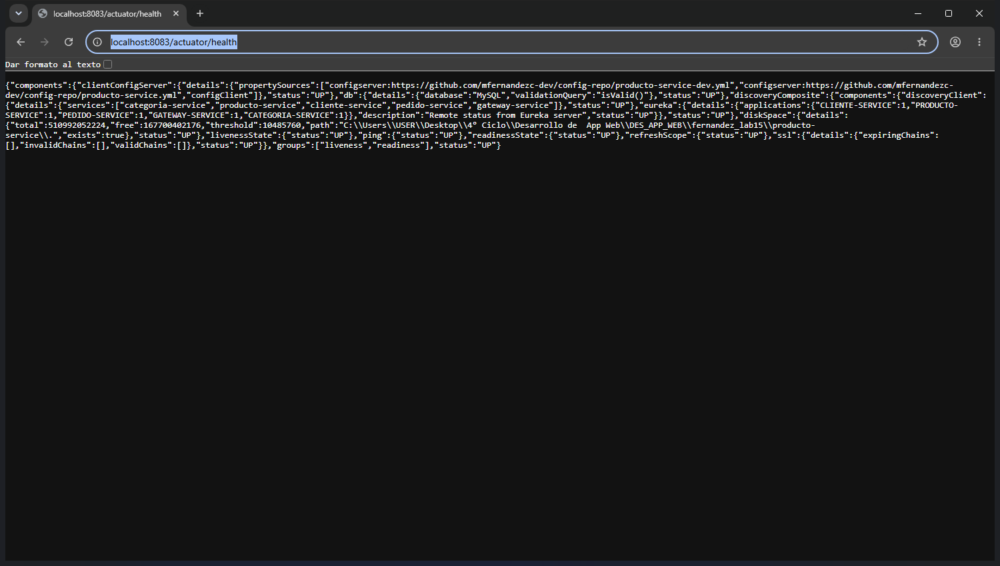
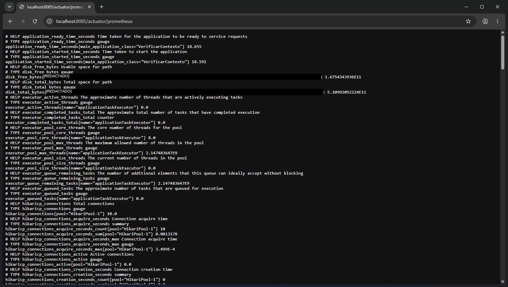
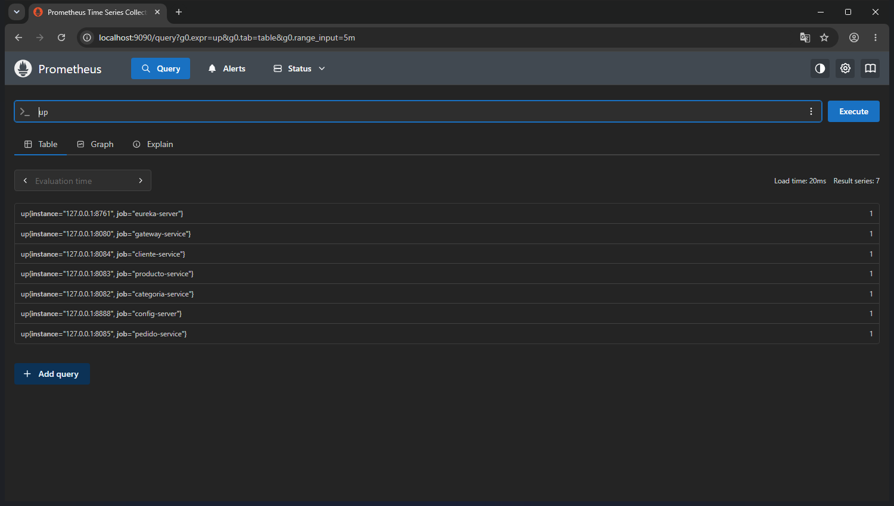
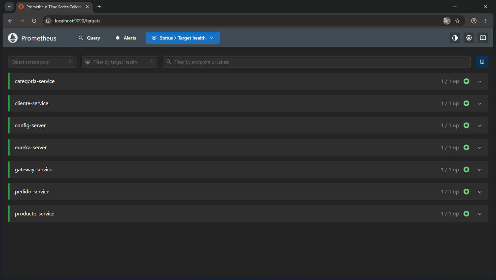
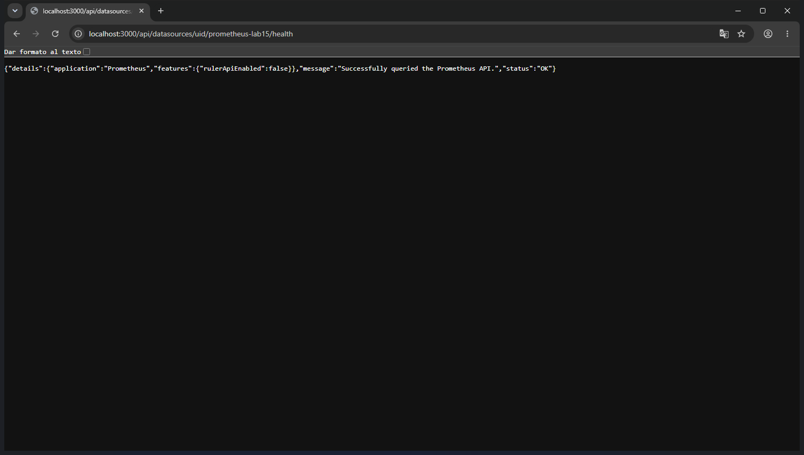
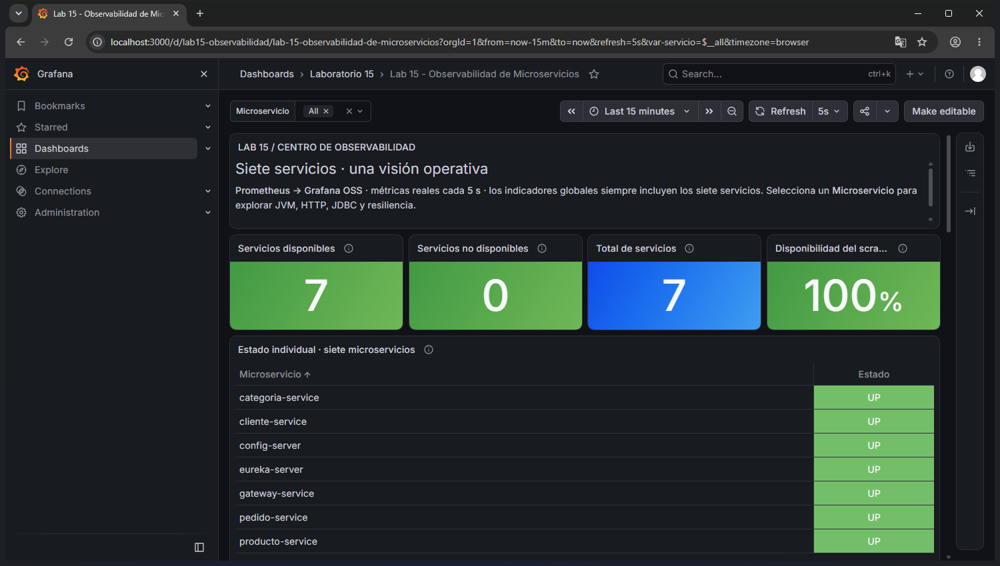
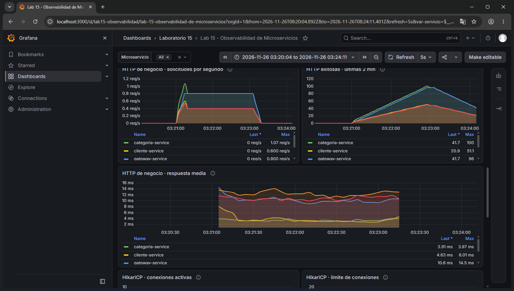

# Laboratorio N.º 15 — Implementación de Observabilidad

**Estudiante:** Michael Fernandez Camarena 
**Institución:** TECSUP 
**Curso:** Desarrollo de Aplicaciones Web 
**Entrega académica:** PASO 06, con pruebas reales de solo lectura.

## Presentación y alcance

Implementé observabilidad sobre la copia independiente del sistema de
microservicios del Lab 14. Conservé Config Server, Eureka, Gateway, OpenFeign
y Resilience4j, y añadí instrumentación, recopilación y visualización de
métricas. La [documentación principal](README.md) contiene arquitectura,
versiones, comandos y 29 imágenes visibles junto a cada actividad.

La guía PDF no está disponible en este checkout. Organicé esta entrega con
las actividades enumeradas para el laboratorio; no atribuyo procedimientos
no proporcionados a páginas específicas. **No implementé tracing distribuido**:
se reconoce como capacidad de observabilidad, no como práctica realizada.

## 1. Spring Boot Actuator

Agregué o conservé una declaración de `spring-boot-starter-actuator` en los
siete POM y configuré `management` para exposición académica en localhost.
Comprobé el índice `/actuator`, salud `/actuator/health` y catálogo
`/actuator/metrics`. Las propiedades de arranque mantienen los valores de
administración sensibles ocultos.

### Evidencia de Producto

La consulta comprueba el estado de la aplicación y sus componentes reales.

**Resultado:** HTTP 200 y UP. El índice y el catálogo están insertados también
en la sección 12 del README; no confundo el catálogo con los valores de todas
las métricas.

## 2. Actividad 1 — Categoria, Cliente y Pedido

Repetí las tres consultas Actuator en los tres servicios solicitados.

| Servicio | Índice | Health | Metrics |
|---|---:|---|---:|
| Categoria, 8082 | 200 | 200, UP | 200 |
| Cliente, 8084 | 200 | 200, UP | 200 |
| Pedido, 8085 | 200 | 200, UP | 200 |

### Categoria

La captura permite comprobar salud sin realizar escrituras de negocio.

**Resultado:** UP. Cliente y Pedido tienen sus imágenes visibles en el README
y todas las respuestas se respaldan en la
[regresión final](evidencias/05-pruebas-finales/REGRESION-ACTUATOR.json).

## 3. Micrometer Registry Prometheus

Incorporé `micrometer-registry-prometheus` una sola vez por POM, sin fijar
manualmente una versión que ya administra Spring Boot. Verifiqué la propiedad
`management.prometheus.metrics.export.enabled=true` y el registro real.

El endpoint `/actuator/prometheus` devuelve texto con HELP, TYPE y muestras,
no el JSON del catálogo de Actuator. El registro instrumenta/exporta; no
instala por sí mismo el servidor Prometheus.

## 4. Actividad 2 — Categoria, Cliente y Pedido

Se comprobó la exposición Prometheus en los puertos 8082, 8084 y 8085,
además de Producto y los tres servicios de infraestructura.

### Exposición de Pedido

Se verifica un endpoint real y las familias disponibles en ese contexto.

**Resultado:** HTTP 200 y formato válido. Las imágenes de los cuatro servicios
de negocio se muestran en la sección 13 del README. No atribuyo JDBC ni
Resilience4j a un servicio donde no estén instrumentados.

## 5. Servidor Prometheus

Se instaló Prometheus 3.13.5 LTS desde la distribución oficial Windows amd64,
verificando SHA-256. El YAML contiene siete jobs, scrape cada 5s, timeout 4s
y `/actuator/prometheus` en los siete puertos correspondientes.
`promtool check config` terminó con exit 0 y SUCCESS.

### Consulta PromQL

Se consulta disponibilidad real del scrape, no datos escritos manualmente.

**Resultado:** siete series con valor 1. `count(up)=7`, `sum(up)=7` y DOWN=0.

### Vista final de targets

Los grupos se colapsaron mediante los controles de la interfaz para mostrar
todos en una sola ventana, manteniendo la URL visible.

**Resultado:** 7 UP y 0 DOWN. `up` prueba scrape correcto, por lo que lo
complementé con salud Actuator y consultas funcionales GET.

## 6. Grafana y conexión a Prometheus

Grafana OSS 13.3.2 se instaló desde su distribución independiente oficial,
con checksum verificado. Escucha solo en localhost:3000 y usa SQLite propia.
Se cambió la clave inicial y se deshabilitaron acceso anónimo, registro
público y telemetría innecesaria. No publico sus credenciales.

El datasource **Prometheus**, UID `prometheus-lab15`, usa acceso proxy a
`http://127.0.0.1:9090`, es predeterminado, no editable e indica intervalo 5s.
Se carga por provisioning, igual que el dashboard.

### Prueba de conexión

La API de health de la fuente realiza la prueba equivalente a Save & test.

**Resultado:** HTTP 200 y OK. Explore devuelve siete series de `up=1`; la
interacción se volvió a verificar durante el cierre.

## 7. Mejora adicional — Dashboard personalizado

Construí un dashboard provisionado de 18 paneles, 17 de datos, con tema
oscuro, variable por job, unidades claras y actualización cada 5s. Los
indicadores globales mantienen el estado de los siete servicios al filtrar.
Incluye JVM, CPU, hilos, uptime, HTTP, HikariCP y Resilience4j.

### Resultado visual

La vista inicial muestra cifras calculadas con series reales de Prometheus.

**Resultado:** 7 disponibles, 0 no disponibles, total 7 y 100% de scrape.
Se verificaron 17 consultas de panel, siete filtros API y refresco real en la UI.

### Tráfico HTTP

Se usaron 24 rondas moderadas, 120 GET, sin operaciones de escritura. La
ventana fija de la captura corresponde al intervalo realmente medido.

**Interpretación:** `rate` expresa solicitudes/s; `increase`, incrementos en
una ventana; la latencia media requiere denominador mayor que cero. Los
huecos sin observaciones no se convierten artificialmente en cero.
El Gateway usa sus timers de rutas, distintos de las URI de los servicios MVC.

## 8. Pruebas funcionales e integridad

| Comprobación final | Resultado |
|---|---|
| Salud | Siete aplicaciones UP |
| Actuator | 21/21 HTTP 200 |
| Exposición Prometheus | 7/7 HTTP 200 |
| Eureka | Cinco aplicaciones esperadas UP |
| Targets | 7 UP, 0 DOWN |
| Grafana / datasource | Saludable / OK |
| Dashboard | 18 paneles; filtros y refresco comprobados |
| Rutas funcionales | Seis GET HTTP 200, sin fallback inesperado |
| Administración vía Gateway | Rutas proxy bloqueadas, 404 |
| Bases y Git | Conteos/hashes e índice/staging sin cambios |

Las seis rutas son categorías, productos, clientes y pedidos por Gateway,
pedido detallado y consulta Cliente→Pedido con ID 1. No se ejecutaron POST,
PUT, PATCH o DELETE de negocio. El detalle público oculta datos personales.

Los cuatro esquemas DEV se compararon con sesiones JDBC READ ONLY y rollback.
Se mantuvieron `validate`, SQL init `never` y las protecciones de sesión de
los mismos procesos. Lab 14, otros laboratorios, config-repo y las evidencias
originales permanecen intactos; MariaDB no fue detenida.

Fuente verificable: [PRUEBAS-FINALES.json](evidencias/05-pruebas-finales/PRUEBAS-FINALES.json)
y [VERIFICACION-PASO06.json](evidencias/05-pruebas-finales/VERIFICACION-PASO06.json).

Durante la recuperación de la sesión se encontraron detenidos los nueve
servicios del laboratorio, con MariaDB todavía activa. Se restauraron una
sola vez usando los artefactos aprobados, sin instalaciones ni compilaciones.
Las sondas finales verifican los nuevos procesos y la integridad; las pruebas
funcionales y las capturas válidas previas se conservan como evidencia histórica.

## 9. Observaciones y límites

- Revisé 59 capturas previas y añadí únicamente seis necesarias. No fabriqué
  imágenes; la arquitectura se expresa como diagrama Mermaid identificado.
- El detalle de Pedido utiliza máscaras sobre la captura real; sus originales
  quedan ignorados en la carpeta operativa, no en el paquete publicable.
- Los gráficos de JDBC y resiliencia solo muestran instrumentación existente.
- La advertencia de compatibilidad de Hibernate/Connector/J con MariaDB se
  conserva como limitación, no como certificación de todas las operaciones SQL.
- Las pruebas locales no equivalen a cobertura CRUD completa ni a una
  plataforma de observabilidad de producción; no hay tracing implementado.
- La publicación se reserva al PASO 07. La vista previa del README es local.

## 10. Cinco conclusiones

1. **Spring Boot Actuator:** aprendí a comprobar la salud y descubrir los
   endpoints que realmente están disponibles en cada servicio, en lugar de
   asumir que iniciar una JVM basta para validar una aplicación.
2. **Micrometer:** comprendí cómo una API común de instrumentación permite
   exportar contadores, timers y gauges a Prometheus sin modificar la lógica
   funcional de los controladores.
3. **Prometheus:** pude configurar targets y utilizar PromQL para relacionar
   disponibilidad de scrape, memoria y tasas con solicitudes reales. También
   aprendí que un target UP no reemplaza una prueba de negocio.
4. **Grafana:** construí un dashboard reproducible con provisioning, filtros
   y unidades adecuadas. Me resultó importante distinguir una serie sin
   observaciones de una medida válida igual a cero.
5. **Observabilidad en microservicios:** comprobé que combinar salud,
   métricas y consultas funcionales me ayuda a comprender mejor las dependencias
   del sistema, aunque debo reconocer los límites de las pruebas realizadas.

## Autor y estado de entrega

**Michael Fernandez Camarena — TECSUP — Desarrollo de Aplicaciones Web.**

Contenido académico del PASO 06 finalizado. Los servicios se conservan activos.
**Preparado para solicitar autorización del PASO 07; no publicado en GitHub.**
