# Laboratorio 15 - Implementación de Observabilidad

**Michael Fernandez Camarena · TECSUP · Desarrollo de Aplicaciones Web**

> Laboratorio académico local completado hasta el **PASO 06**. Pruebas reales,
> capturas auténticas y documentación preparada para una publicación posterior.
> **PASO 07 no ejecutado: este trabajo todavía no se ha publicado en GitHub.**

## 1. Presentación

Este proyecto incorpora observabilidad a siete aplicaciones Spring: cuatro
servicios de negocio, Config Server, Eureka y Gateway. Actuator expone el
estado y las métricas; Micrometer las adapta al formato Prometheus; Prometheus
recopila las series y Grafana permite explorarlas en un dashboard reproducible.

Se conserva la arquitectura funcional del Lab 14 en una carpeta independiente.
Las verificaciones de esta fase son de **solo lectura** y no alteran sus bases
compartidas. No se implementó **tracing distribuido**, centralización de logs
ni alertas: son capacidades relacionadas, pero no prácticas realizadas aquí.

**Vista destacada del resultado.** Se comprueban los indicadores globales y
la carga real del dashboard, con refresco de 5 segundos.

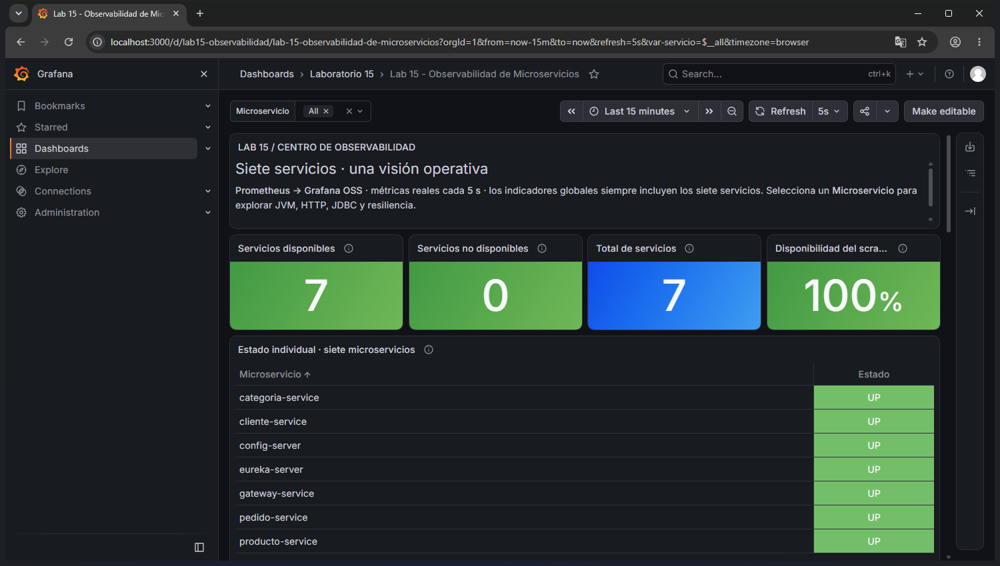

**Interpretación:** 7 disponibles, 0 no disponibles, total 7 y 100% de éxito
del scrape. Este porcentaje instantáneo no representa un SLO histórico.

[Informe académico](ENTREGABLE-LAB15.md) ·
[Pruebas finales](evidencias/05-pruebas-finales/PRUEBAS-FINALES.json) ·
[Verificación PASO 06](evidencias/05-pruebas-finales/VERIFICACION-PASO06.json)

## 2. Objetivos

- Exponer salud y métricas con Spring Boot Actuator sin cambiar el negocio.
- Integrar `micrometer-registry-prometheus` en las siete aplicaciones.
- Configurar siete targets locales y consultar sus series mediante PromQL.
- Conectar Grafana con Prometheus y visualizar métricas reales por servicio.
- Verificar disponibilidad, rutas funcionales, privacidad e integridad.
- Documentar evidencias visibles y una ejecución reproducible, sin secretos.

Los requisitos obligatorios se distinguen de las mejoras en la
[matriz de cumplimiento](evidencias/05-pruebas-finales/AUDITORIA-GUIA.json).
La guía PDF no está en el checkout: la auditoría utiliza las actividades
enumeradas en la autorización docente, sin atribuir una lectura del PDF.

## 3. Tecnologías utilizadas y versiones efectivas

| Componente | Versión comprobada / uso |
|---|---|
| Spring Boot | 4.1.2 |
| Spring Cloud BOM | 2025.1.4 |
| JDK de ejecución/compilación | Amazon Corretto 26.0.2.1 |
| Nivel Java de infraestructura | 17: Config Server, Eureka y Gateway |
| Nivel Java de negocio | 25: Categoria, Producto, Cliente y Pedido |
| Maven | 3.9.16; wrappers conservados |
| Micrometer Registry Prometheus | 1.17.2, administrado por Spring Boot |
| Cliente Java Prometheus | 1.7.0 |
| Resilience4j | 2.4.0; configuración existente preservada |
| Prometheus | 3.13.5 LTS, Windows amd64 |
| Grafana OSS | 13.3.2 estable, Windows amd64 |
| Base de datos del proyecto | MariaDB 10.4.32 de XAMPP |
| Automatización | Windows PowerShell 5.1, Node.js y Chrome/CDP |

MariaDB es compatible con el protocolo MySQL; **no se presenta como una
instalación de MySQL Server**. Las versiones se contrastan con los recibos,
árboles de dependencias e informes de cada paso, no con supuestos de la guía.

## 4. Arquitectura de microservicios

Gateway conserva cuatro rutas de negocio. Los servicios usan Eureka para
descubrimiento y Config Server para configuración centralizada. Producto
consulta Categoria; Pedido obtiene Cliente/Producto; Cliente consulta Pedido
en su endpoint compuesto. Las llamadas Feign conservan Resilience4j.

Prometheus consulta **directamente** `/actuator/prometheus` de cada aplicación;
no pasa por Gateway. Grafana consulta exclusivamente Prometheus, no MariaDB.

## 5. Diagrama Mermaid compatible con GitHub

El siguiente es un **diagrama técnico de la arquitectura implementada**, no
una captura de ejecución. Por ello no se fabrica `01-arquitectura-servicios.png`.

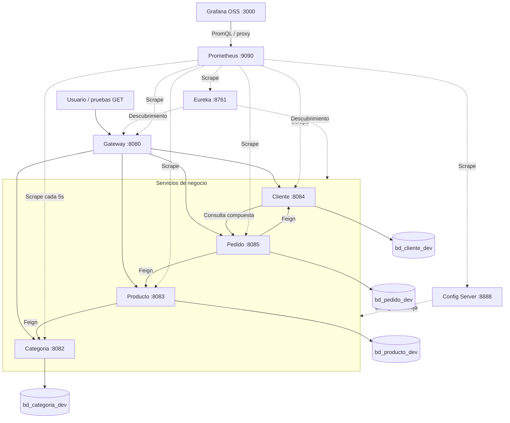

Los cuatro esquemas pertenecen al MariaDB existente de XAMPP. Las flechas
de negocio representan dependencias reales, no autorización para escribir
en esta fase.

## 6. Estructura del proyecto

```text
fernandez_lab15/
├── config-server/        ├── eureka-server/      ├── gateway-service/
├── categoria-service/    ├── producto-service/
├── cliente-service/      ├── pedido-service/
├── observabilidad/
│   ├── prometheus/prometheus.yml
│   └── grafana/{dashboards,provisioning}/
├── scripts/              # Arranque seguro, pruebas y auditorías
├── evidencias/
│   ├── 01-actuator/      ├── 02-micrometer/
│   ├── 03-prometheus/    ├── 04-grafana/
│   ├── 05-pruebas-finales/
│   └── readme/           # Solo las seis capturas adicionales necesarias
├── ENTREGABLE-LAB15.md
└── README.md
```

`.runtime/`, `target/`, binarios, SQLite, TSDB, credenciales, logs y perfiles
de navegador son operativos e **ignorados por Git**. No forman parte del
paquete publicable.

## 7. Requisitos previos

Para otra computadora se necesitan Java compatible con los niveles 17/25,
Maven o los wrappers, Windows PowerShell 5.1, Node.js, MariaDB/XAMPP con los
esquemas/tablas requeridos y acceso de lectura al Config Server autorizado.
Prometheus y Grafana deben instalarse explícitamente desde fuentes oficiales,
validando sus checksums. Chrome se requiere solo para automatizar capturas.

**Clonar no prepara automáticamente este entorno.** En una máquina nueva:

1. En una terminal independiente, clone la URL autorizada del repositorio
   cuando exista y sitúese en `fernandez_lab15`. La publicación no se realiza aquí.
2. Instale las herramientas requeridas y adapte su selección local en los
   scripts de entorno, sin cambiar versiones/puertos del laboratorio.
3. Prepare, fuera de las pruebas de solo lectura, los cuatro esquemas que ya
   deben existir. Configure credenciales locales válidas sin versionarlas.
4. Compruebe acceso al commit de configuración indicado en la sección 9.
5. Compile explícitamente con `Compilar-Lab15.ps1 -Paso 03`; no hay JAR en Git.
   No ejecutar pruebas heredadas que puedan conectar a bases compartidas.
6. Si las herramientas aún no están instaladas, ejecute conscientemente los
   instaladores `Instalar-Prometheus.ps1` y `Instalar-Grafana.ps1` desde Lab 15.
   Rechazan destinos existentes; no forman parte del arranque automático.
7. Inicie y verifique con los scripts generales. Los registros de procesos,
   sondas y credenciales se generan localmente y no se copian de otra cuenta.

Los scripts actuales seleccionan el JDK en el perfil local y Node.js/Chrome
en sus ubicaciones Windows comprobadas. Esos requisitos deben revisarse al
migrar; no se promete funcionamiento inmediato después de clonar.

## 8. Configuración de bases de datos

| Servicio | Esquema DEV | Tablas verificadas | Filas de referencia |
|---|---|---|---:|
| Categoria | bd_categoria_dev | categoria | 2 |
| Producto | bd_producto_dev | producto | 2 |
| Cliente | bd_cliente_dev | clientes | 1 |
| Pedido | bd_pedido_dev | pedido y detalle_pedido | 1 + 1 |

Se mantienen `hibernate.ddl-auto=validate`, SQL init `never`, DDL desactivado,
Flyway/Liquibase deshabilitados y Hikari/sesiones JDBC de solo lectura.
El lanzador impone estas propiedades por argumentos, con precedencia sobre
el remoto que conserva `update`. Los YAML locales son una defensa adicional,
no una garantía de precedencia por sí solos.

El lector JDBC compara conteos, SHA-256 de estructuras y todas las filas,
en una transacción **READ ONLY** con rollback. No cambia ajustes globales.
Grafana utiliza su SQLite propia y Prometheus su TSDB; ninguno usa estas bases.

## 9. Config Server y Eureka

Repositorio de configuración de lectura:
`https://github.com/mfernandezc-dev/config-repo`.
Commit fijo: `39a22fc2d854d3549ce77cbb347cd20101b0d13f`.

```yaml
spring:
  cloud:
    config:
      server:
        git:
          default-label: 39a22fc2d854d3549ce77cbb347cd20101b0d13f
          clone-on-start: true
```

No se modifica ni publica config-repo. Los clientes arrancan con perfil DEV
y label fijo. El caché temporal se genera fuera del repositorio.

### Registro de aplicaciones en Eureka

La interfaz comprueba los registros de los cuatro servicios de negocio y Gateway.

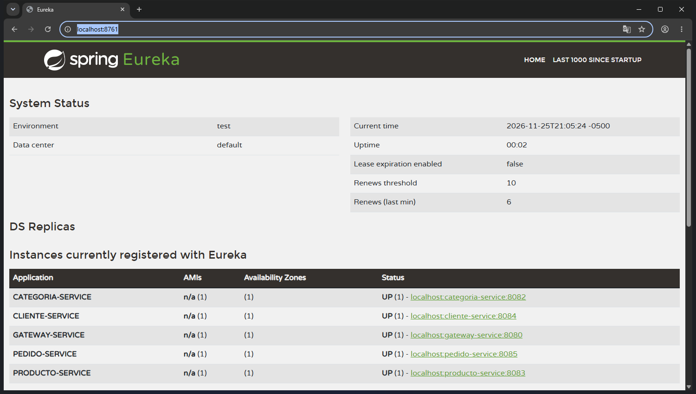

**Resultado:** cinco aplicaciones UP. Captura histórica auténtica del PASO 02;
el registro se revalidó en PASO 06. Config Server y Eureka no se cuentan como
clientes que deban autorregistrarse.

## 10. Servicios y puertos

| Componente | Puerto | Escucha actual |
|---|---:|---|
| Config Server | 8888 | 127.0.0.1 |
| Eureka | 8761 | 127.0.0.1 |
| Gateway | 8080 | 127.0.0.1 |
| Categoria | 8082 | 127.0.0.1 |
| Producto | 8083 | 127.0.0.1 |
| Cliente | 8084 | 127.0.0.1 |
| Pedido | 8085 | 127.0.0.1 |
| Prometheus | 9090 | 127.0.0.1 |
| Grafana | 3000 | 127.0.0.1 |
| MariaDB XAMPP existente | 3306 | Listener previo conservado, sin reconfigurarlo |

No ejecutar Lab 14 y Lab 15 simultáneamente: comparten puertos, descubrimiento
y bases. Los scripts no liberan puertos matando procesos ajenos.

## 11. Orden de ejecución y comandos PowerShell

Orden: comprobar MariaDB → Config Server → Eureka → Categoria → Producto →
Cliente → Pedido → Gateway → Prometheus → Grafana.

Desde la carpeta del laboratorio:

```powershell
powershell -NoProfile -ExecutionPolicy Bypass -File .\scripts\Iniciar-Todo-Lab15.ps1
powershell -NoProfile -ExecutionPolicy Bypass -File .\scripts\Verificar-Todo-Lab15.ps1
powershell -NoProfile -ExecutionPolicy Bypass -File .\scripts\Detener-Todo-Lab15.ps1 -WhatIf
# Detención real solo cuando se desee finalizar la sesión:
powershell -NoProfile -ExecutionPolicy Bypass -File .\scripts\Detener-Todo-Lab15.ps1
```

El inicio es **idempotente para procesos propios saludables**: comprueba
identidad/fecha/artefacto y los reutiliza; no reinstala, recompila servicios
ni reinicia automáticamente un proceso enfermo. En un arranque frío necesita
los JAR/recibos aprobados y puede compilar únicamente las sondas auxiliares.
La detención valida identidades y conserva **MariaDB, procesos ajenos y datos**.
`-WhatIf` se comprobó sin detener el conjunto.

La contraseña administrativa inicial de Grafana ya fue cambiada. La nueva
credencial está cifrada con Windows DPAPI en la carpeta privada ignorada.
No se incluye en esta documentación ni se traslada entre cuentas de Windows.

## 12. Implementación de Spring Boot Actuator

Cada uno de los siete POM declara una sola vez:

```xml
<dependency>
    <groupId>org.springframework.boot</groupId>
    <artifactId>spring-boot-starter-actuator</artifactId>
</dependency>
```

Configuración relevante, integrada sin reemplazar Resilience4j:

```yaml
server:
  address: 127.0.0.1
management:
  endpoints:
    web:
      exposure:
        include: "*"
  endpoint:
    health:
      show-details: always
```

Exponer `"*"` es exclusivamente académico en localhost. `env/configprops`
ocultan valores; no se descargan dumps ni configuraciones sensibles completas.

### Producto: índice administrativo

Se consulta `/actuator` para descubrir los endpoints realmente disponibles.

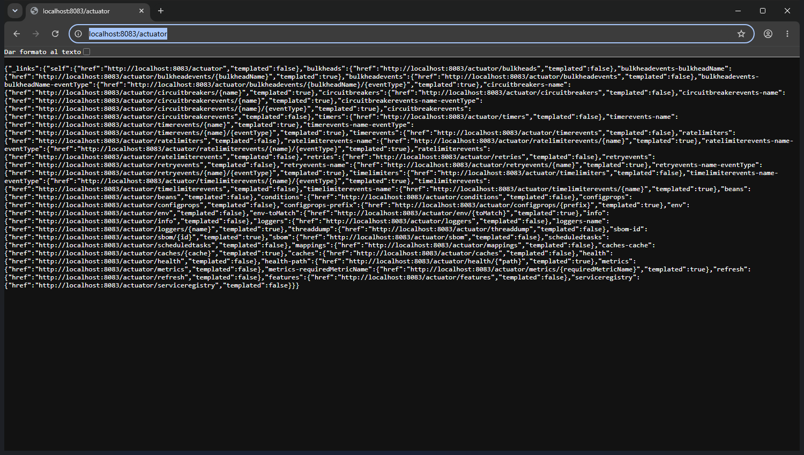

**Resultado:** HTTP 200 y enlaces administrativos. La captura corresponde al
PASO 02, anterior a agregar el exportador Prometheus.

### Producto: salud

Se verifica `/actuator/health`, sin invocar operaciones CRUD de escritura.

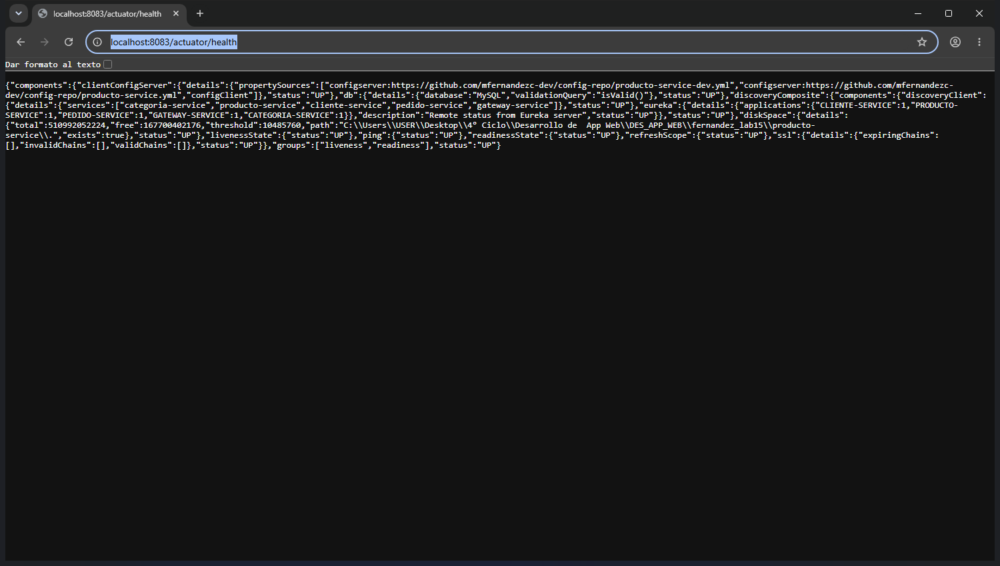

**Resultado:** HTTP 200 y estado agregado UP, revalidado al cierre.

### Producto: catálogo de métricas

`/actuator/metrics` enumera nombres; `/actuator/metrics/{nombre}` devuelve medidas.

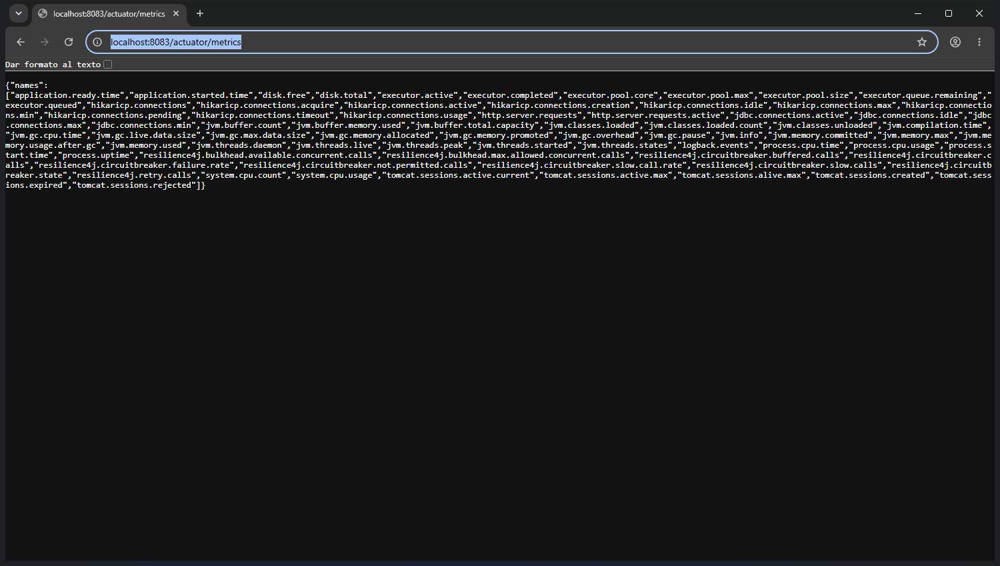

**Resultado:** métricas JVM, proceso, HTTP y las familias realmente instrumentadas.

### Actividad 1: Categoria, Cliente y Pedido

Se comprobaron `/actuator`, `/actuator/health` y `/actuator/metrics` en cada
servicio. La [regresión final](evidencias/05-pruebas-finales/REGRESION-ACTUATOR.json)
conserva las nueve comprobaciones y las otras doce de infraestructura/Producto.

**Categoria:** salud y conectividad de sus componentes reales.


**Resultado:** HTTP 200 y UP.

**Cliente:** mismo procedimiento, sin guardar sus datos personales de negocio.


**Resultado:** HTTP 200 y UP.

**Pedido:** salud de la aplicación y sus componentes instrumentados.


**Resultado:** HTTP 200 y UP. Las capturas históricas se conservan sin alteración.

## 13. Integración de Micrometer Prometheus

Micrometer es la API de instrumentación. Su registro Prometheus adapta
contadores, timers y gauges; agregarlo **no instala el servidor Prometheus**.

```xml
<dependency>
    <groupId>io.micrometer</groupId>
    <artifactId>micrometer-registry-prometheus</artifactId>
</dependency>
```

```yaml
management:
  prometheus:
    metrics:
      export:
        enabled: true
```

Spring Boot administra la versión; no se fijó una versión manual en cada POM.
`jvm.memory.used` se normaliza como `jvm_memory_used_bytes`. Los timers HTTP
exponen `_seconds_count` y `_seconds_sum`. No todos los servicios tienen JDBC
ni las mismas instancias de Resilience4j.

### Producto: exposición de series

Se consulta `/actuator/prometheus` directamente en 8083.


**Resultado:** HTTP 200, texto Prometheus, HELP/TYPE y muestras numéricas.
Los ocultamientos de rutas locales están documentados; no cambian métricas.

### Actividad 2: Categoria

Se comprueba el exportador en el puerto propio del servicio.

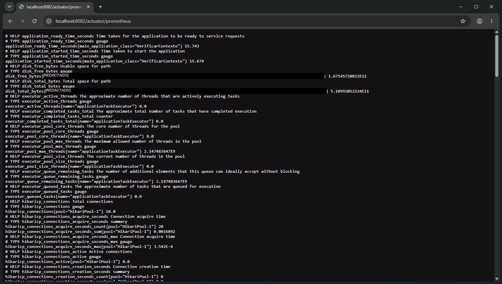

**Resultado:** HTTP 200 y familias reales de JVM, HTTP y pool JDBC.

### Actividad 2: Cliente

La misma integración expone las medidas de Cliente.

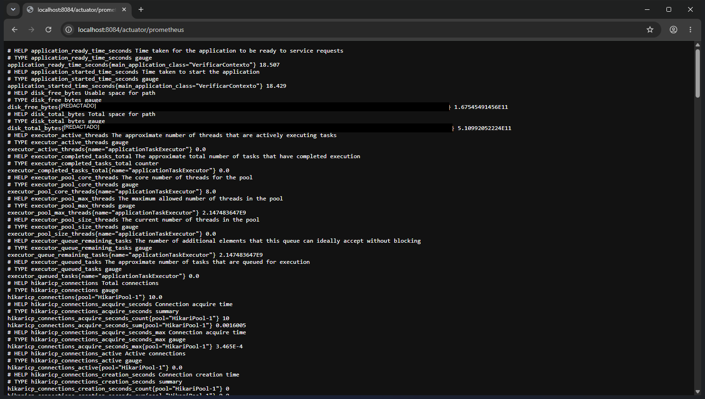

**Resultado:** HTTP 200, formato válido y métricas del contexto real.

### Actividad 2: Pedido

Se valida su endpoint sin escribir pedidos ni detalles.

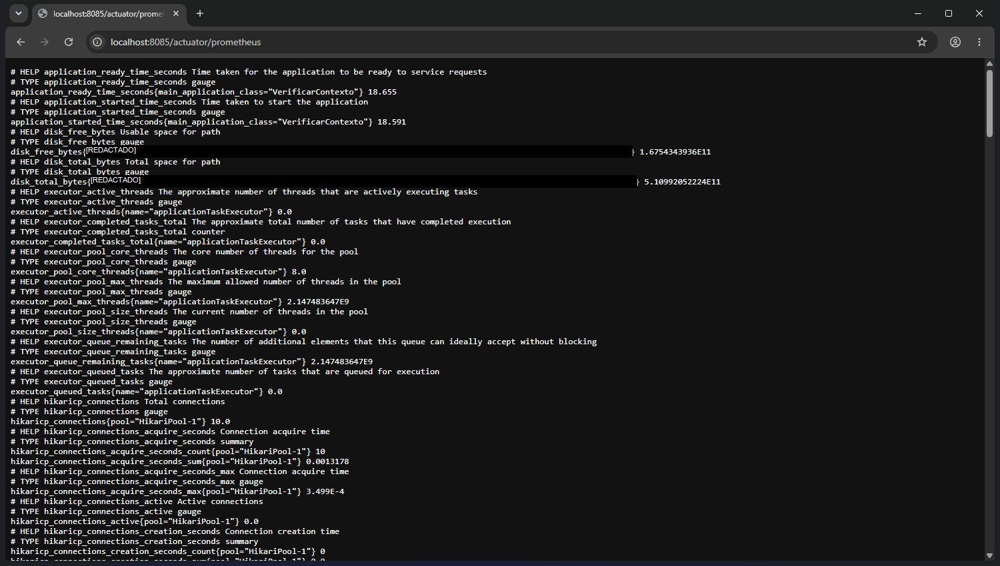

**Resultado:** HTTP 200. Los siete exportadores, incluida infraestructura,
se revalidaron en PASO 06; estas cuatro imágenes corresponden al PASO 03.

## 14. Instalación y configuración de Prometheus

Prometheus **3.13.5 LTS** se instaló como distribución portable Windows amd64
en `C:\Prometheus`, validando SHA-256 oficial antes de ejecutar. No se
reinstaló durante las pruebas finales.

[Recibo y checksum](evidencias/03-prometheus/INSTALACION-PROMETHEUS.json) ·
[Configuración completa](observabilidad/prometheus/prometheus.yml).

```yaml
global:
  scrape_interval: 5s
  evaluation_interval: 5s
  scrape_timeout: 4s
scrape_configs:
  - job_name: "producto-service"
    metrics_path: "/actuator/prometheus"
    static_configs:
      - targets: ["127.0.0.1:8083"]
```

El archivo completo contiene siete jobs y siete destinos locales; el fragmento
muestra uno sin copiar innecesariamente los demás. Listener 127.0.0.1:9090,
retención 1d y TSDB bajo `.runtime/prometheus/data`. Admin API/lifecycle apagados.

### Configuración de siete jobs

La captura muestra una copia exacta del YAML real validado.

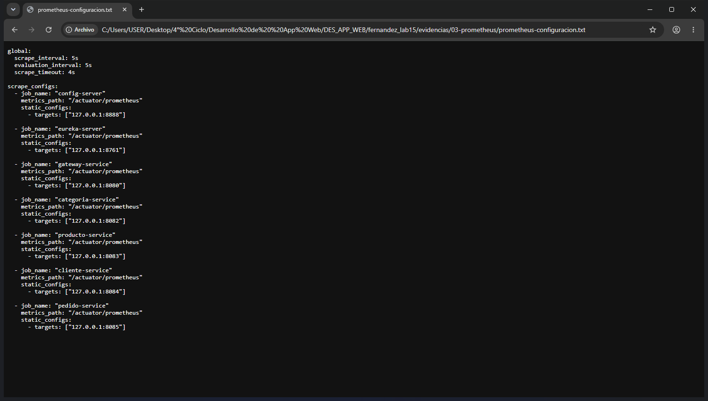

**Resultado:** siete jobs, sus puertos y `/actuator/prometheus`.

### Validación de sintaxis

Se ejecutó `promtool.exe check config` antes del arranque.

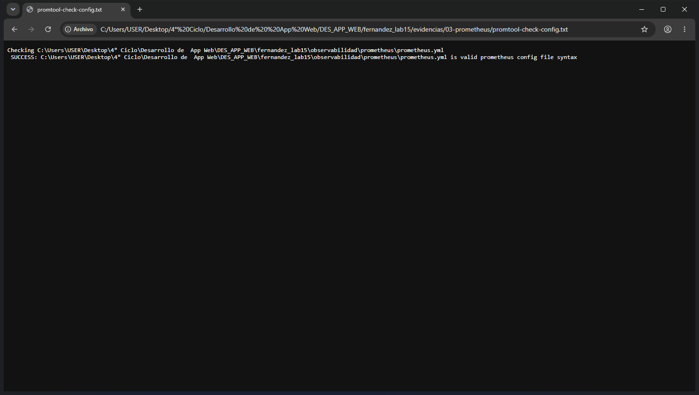

**Resultado:** exit 0, SUCCESS. Salida histórica del PASO 04, no HTML simulado.

### Targets finales

La vista nueva del PASO 06 reúne los siete grupos, colapsados mediante los
controles reales de la interfaz para que todos sean visibles.

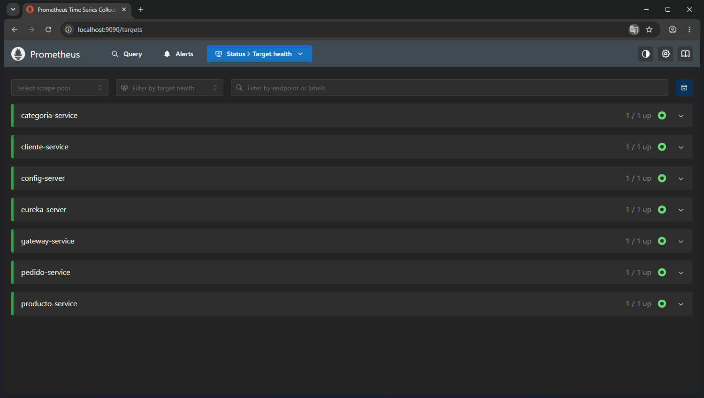

**Resultado:** 7 UP, 0 DOWN, sin errores de scrape.

## 15. Consultas PromQL y explicación

| Expresión | Interpretación |
|---|---|
| `up` | Una serie por target; 1 indica scrape correcto |
| `count(up)` | Cantidad de targets que tienen serie |
| `sum(up)` | Targets disponibles |
| `count(up == 0) or vector(0)` | Targets DOWN; cero cuando no hay coincidencias |
| `100 * avg(up)` | Porcentaje instantáneo de éxito de scrape |
| `sum by (job) (jvm_memory_used_bytes) / 1024 / 1024` | Memoria JVM por job, MiB |
| `100 * process_cpu_usage` | CPU del proceso, porcentaje |
| `jvm_threads_live_threads` | Hilos Java activos |
| `process_uptime_seconds` | Tiempo activo, segundos |
| `hikaricp_connections_active` | Conexiones ocupadas, solo servicios JDBC |
| `hikaricp_connections_max` | Capacidad configurada del pool |

### Disponibilidad con `up`

Se ejecuta PromQL contra el servidor local, no un valor escrito manualmente.

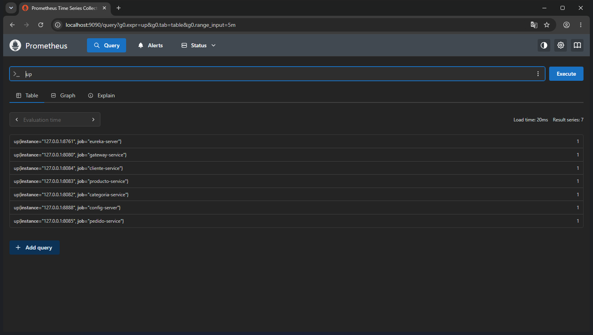

**Resultado:** siete series con valor 1; captura PASO 04 y consulta revalidada.

### Memoria JVM

La agregación suma áreas de memoria de cada job y convierte bytes a MiB.

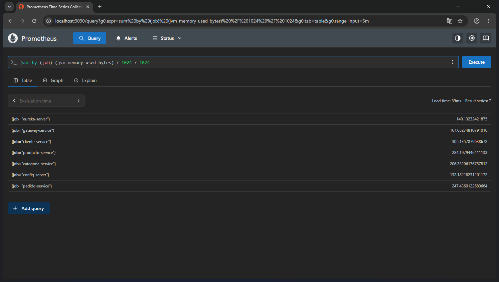

**Interpretación:** siete valores reales variables, no valores que deban
permanecer iguales entre capturas.

### Peticiones de negocio

Para contadores se calcula una tasa, no una lectura acumulada como si fuera velocidad.

```promql
sum by (job) (
  rate(http_server_requests_seconds_count{uri=~"/api/.*"}[1m])
)
```

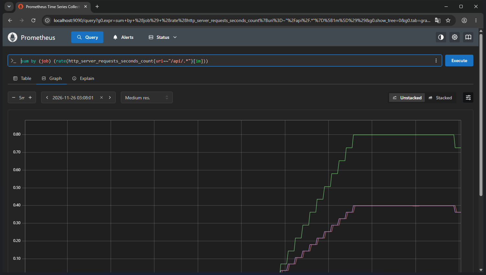

**Resultado:** crecimiento durante la ventana de tráfico histórico conservada.
Las consultas completas de ese paso están en [Consultas-Prometheus.mjs](scripts/Consultas-Prometheus.mjs).

## 16. Instalación y configuración de Grafana

Grafana OSS **13.3.2** se instaló en `C:\Grafana` desde el paquete oficial
independiente Windows amd64 `.tar.gz`, con SHA-256 coincidente. No se usa MSI,
Docker ni un servicio de Windows. [Recibo oficial](evidencias/04-grafana/INSTALACION-GRAFANA.json).

La configuración se genera en `.runtime/grafana/grafana-lab15.ini`.
SQLite, logs, plugins instalables y provisioning operativo quedan bajo esa
carpeta. Se deshabilitan acceso anónimo, registro público, telemetría,
comprobaciones externas innecesarias, precarga de plugins y snapshots externos.
El acceso inicial fue cambiado de forma segura; su secreto no es publicable.

### Inicio autenticado

Se accede a la interfaz local con autenticación administrativa.

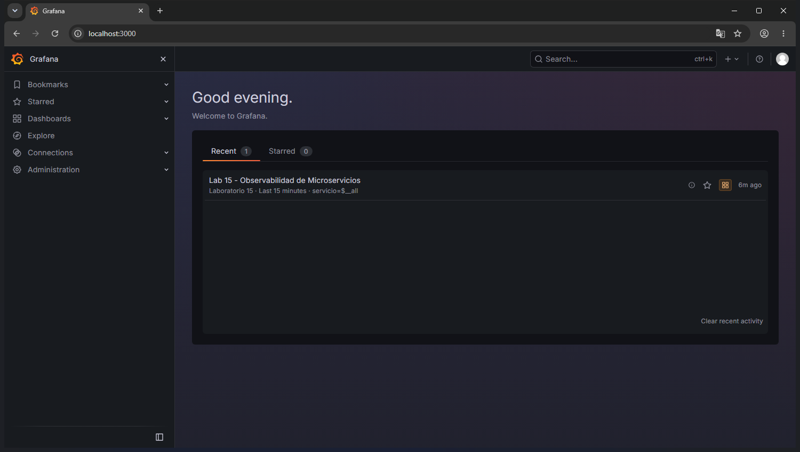

**Resultado:** Grafana disponible y dashboard registrado. Imagen histórica
PASO 05, autenticación y salud nuevamente comprobadas al cierre.

## 17. Conexión del datasource

[Provisioning del datasource](observabilidad/grafana/provisioning/datasources/prometheus.yml):

```yaml
apiVersion: 1
datasources:
  - name: Prometheus
    uid: prometheus-lab15
    type: prometheus
    access: proxy
    url: http://127.0.0.1:9090
    isDefault: true
    editable: false
    jsonData:
      timeInterval: 5s
```

### Fuente cargada desde configuración

Se comprueba la URL y el estado de fuente provisionada, no editable desde la UI.

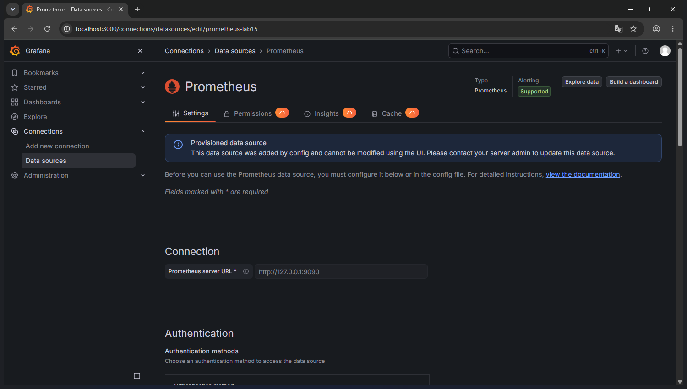

**Resultado:** nombre Prometheus, UID estable, proxy y fuente predeterminada.

### Prueba equivalente a Save & test

La API `/api/datasources/uid/prometheus-lab15/health` prueba la conexión real
sin tener que guardar una fuente que está gobernada por provisioning.

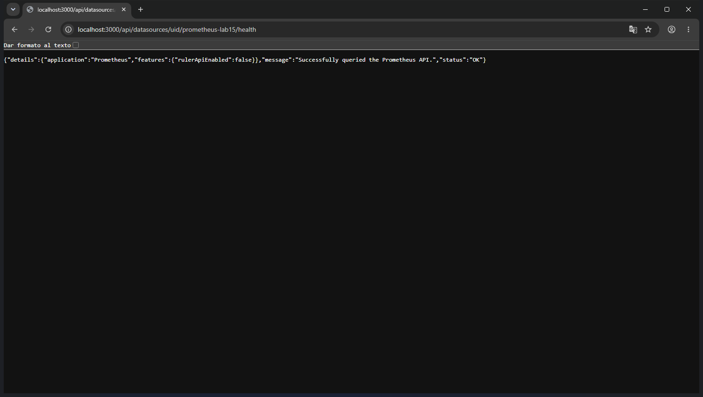

**Resultado:** HTTP 200, `status=OK`, “Successfully queried the Prometheus API”.

### Explore: consulta `up`

Se consulta Prometheus a través de Grafana Explore; la interacción se repitió
en PASO 06 y se conserva la captura original válida.

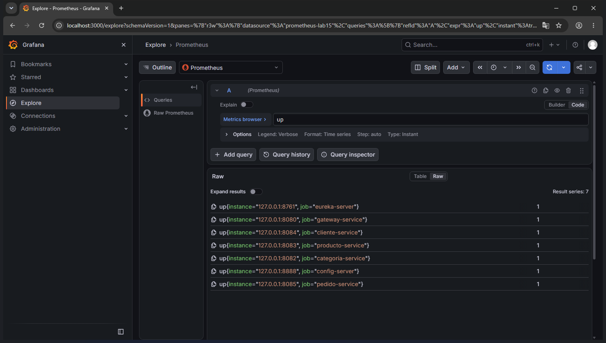

**Resultado:** siete series `up=1`, no una respuesta simulada.

## 18. Dashboard personalizado

[Abrir Lab 15 - Observabilidad de Microservicios](http://localhost:3000/d/lab15-observabilidad/lab-15-observabilidad-de-microservicios)

[JSON reproducible](observabilidad/grafana/dashboards/lab15-observabilidad.json) ·
[Proveedor](observabilidad/grafana/provisioning/dashboards/lab15.yml).

**18 paneles: uno introductorio y 17 de datos.** Los 15 indicadores/categorías
solicitados se complementan con dos paneles reales de resiliencia.

| Grupo | Paneles / unidades |
|---|---|
| Global | Disponibles, DOWN, total y porcentaje de scrape |
| Estado individual | Tabla de siete servicios: UP verde, DOWN rojo, sin datos distinto de DOWN |
| JVM | Memoria MiB, CPU %, hilos y uptime |
| HTTP | Tasa de negocio, respuestas 200 en 2m y latencia media ms |
| JDBC | HikariCP activas y máximas, solo donde existe pool |
| Resiliencia | Tasa de llamadas CircuitBreaker; CLOSED y Retry adicionales |

La variable **Microservicio** permite uno, varios o todos los jobs. Los
indicadores globales y la tabla de los siete **no dependen del filtro**.
Rango inicial 15m, refresco 5s. El proveedor recarga archivos cada 10s; usa
`${LAB15_GRAFANA_DASHBOARDS}`, resuelta dinámicamente por el lanzador, sin una
ruta absoluta de esta computadora en el YAML versionable.

### JVM y CPU

Se muestran series temporales reales, con leyendas por job y unidades consistentes.

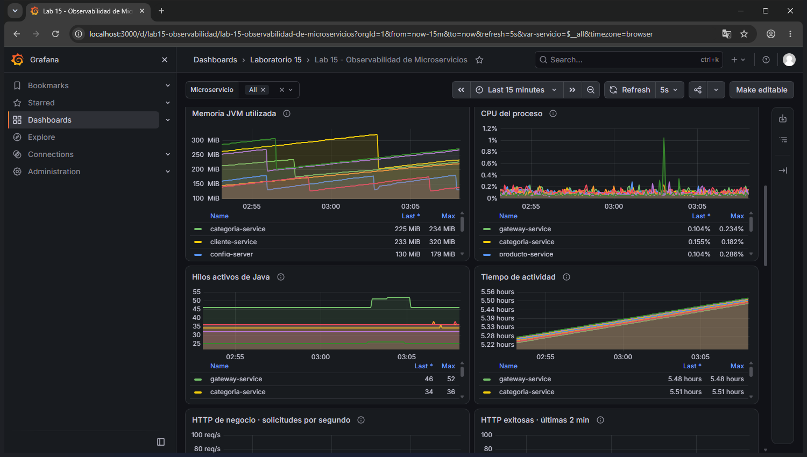

**Interpretación:** la memoria puede bajar por GC; CPU se expresa en porcentaje
y usa escala automática para distinguir cargas pequeñas.

### HTTP con tráfico real del PASO 06

Se generaron 24 rondas moderadas, 120 GET, y se fija en la URL la ventana
medida con un minuto de margen. No se repite tráfico para mantener un gráfico.

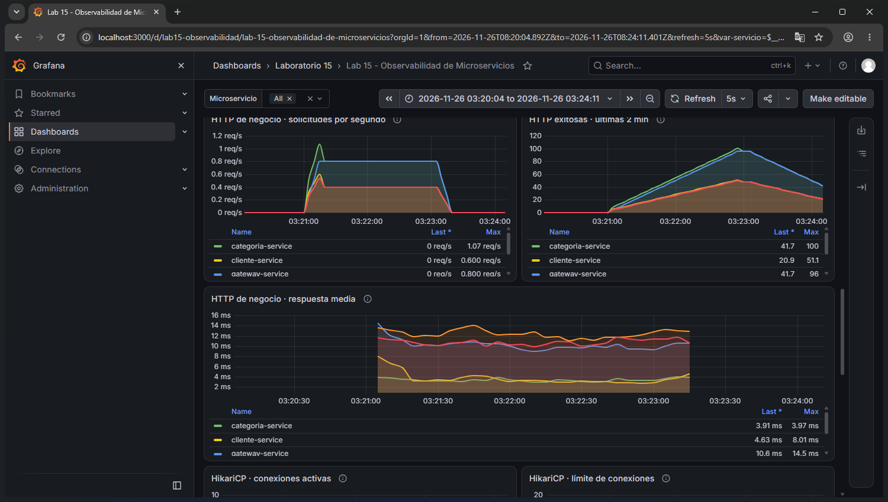

**Interpretación:** tasas e incrementos de negocio y latencia media observada.
MVC filtra `/api/.*`; Gateway utiliza su familia
`spring_cloud_gateway_requests_seconds_count` / `_sum`. No se cuentan sus
scrapes como peticiones de ruta. Se usa `rate` con `$__rate_interval` (1m en
las pruebas API), `increase` para exitosas y un denominador **mayor que cero**
para latencia. Sin solicitudes se deja un hueco, no un cero artificial.

### HikariCP

Los pools pertenecen únicamente a Categoria, Producto, Cliente y Pedido.

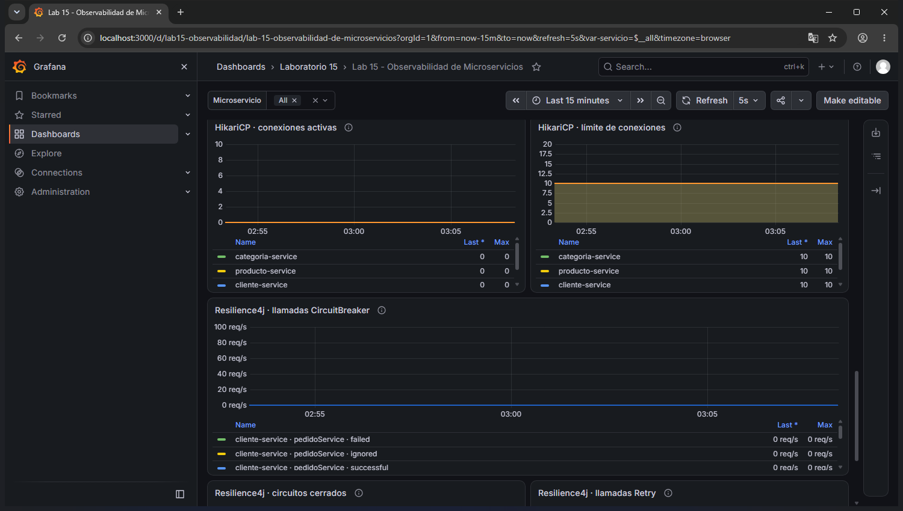

**Resultado:** activas cero entre consultas es normal; el límite observado
es 10. No se atribuyen métricas JDBC a Gateway, Eureka o Config Server.

### Resilience4j

Se consultan las series instrumentadas de CircuitBreaker y Retry por job,
nombre y tipo de resultado.

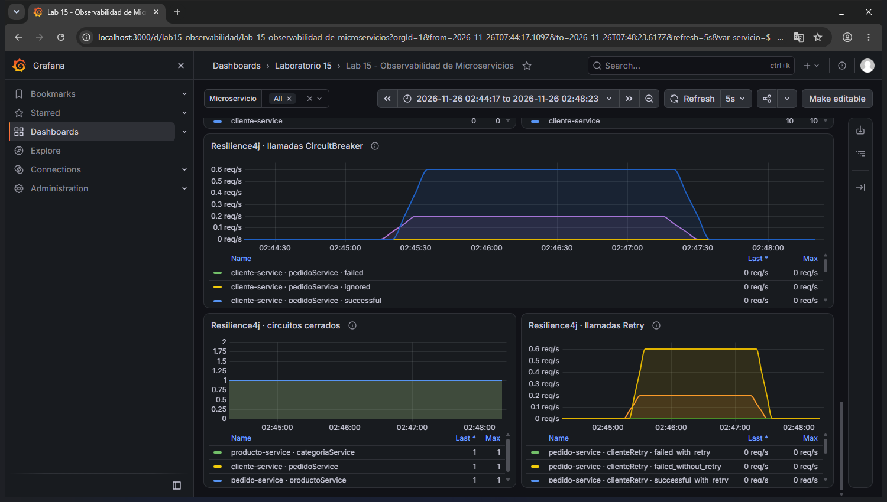

**Resultado:** CircuitBreaker en Producto/Cliente/Pedido; Retry en Producto/Pedido.
La captura fija una ventana real del PASO 05. No se inventan series para otros jobs.

### Filtro de Producto

Se selecciona `producto-service`, manteniendo el alcance global de disponibilidad.

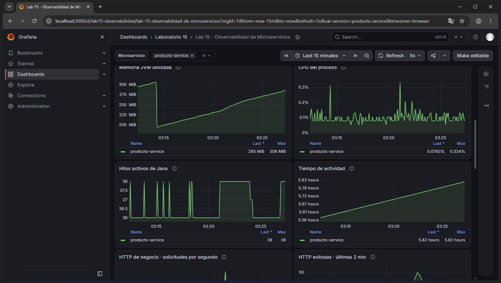

**Resultado:** JVM/CPU corresponden a Producto; el verificador UI y las pruebas
API confirman el filtro y el refresco. Filtrar infraestructura puede dejar
JDBC o HTTP de negocio sin datos: es ausencia de instrumentación/observaciones,
no un DOWN del servicio.

## 19. Pruebas funcionales

| URL GET local | Resultado | Comprobación |
|---|---|---|
| `http://localhost:8080/api/categorias` | 200, 2 elementos | Coincide con servicio directo |
| `http://localhost:8080/api/productos` | 200, 2 elementos | Categorias compuestas reales |
| `http://localhost:8080/api/clientes` | 200, 1 elemento | Respuesta pública sanitizada |
| `http://localhost:8080/api/pedidos` | 200, 1 elemento | Coincide con servicio directo |
| `http://localhost:8085/api/pedidos?detallado=true` | 200 | Cliente/Producto coherentes |
| `http://localhost:8084/api/clientes/pedidos/1` | 200 | Consulta compuesta sin fallback inesperado |

### Productos mediante Gateway

La prueba atraviesa la ruta de negocio real del Gateway.

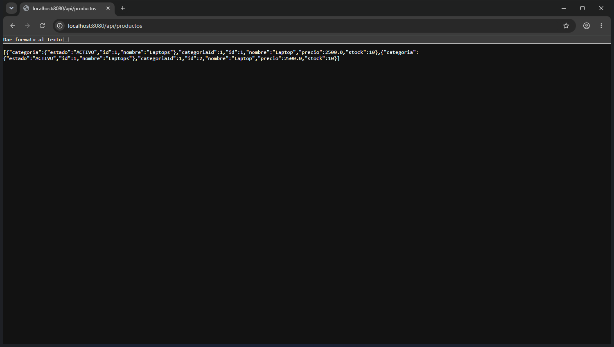

**Resultado:** productos y sus categorías, HTTP 200, sin fallback inesperado.

### Pedido detallado

La consulta obtiene datos relacionados sin escribir pedidos ni modificar clientes.

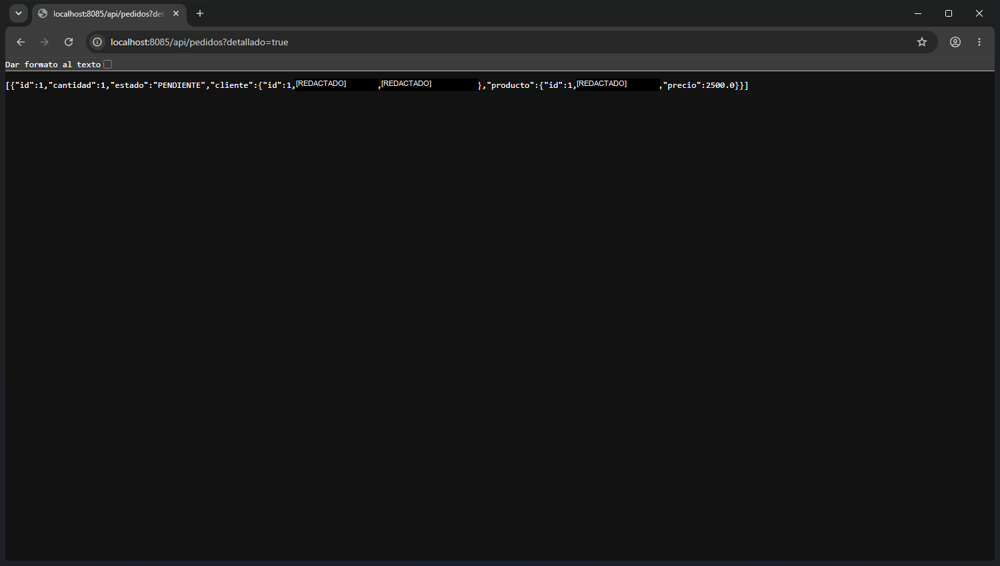

**Resultado:** HTTP 200 y relaciones reales; nombres/apellidos se ocultan
mediante máscaras sobre los píxeles de la captura. Los originales quedan
solo en `.runtime/`. La respuesta JSON publicable también está sanitizada.

Las rutas `/<servicio>/actuator/prometheus` a través de Gateway devuelven
404; los endpoints administrativos se consultan directamente en localhost.
Solo se usaron GET de negocio; no pruebas CRUD de escritura ni fallos forzados.

## 20. Evidencias organizadas por actividad

| Actividad | Informe y comprobaciones | Evidencia visual |
|---|---|---|
| Preparación independiente | [PASO01](evidencias/05-pruebas-finales/PASO01.md) | Sin capturas atribuidas a ese paso |
| Actuator / Actividad 1 | [PASO02](evidencias/01-actuator/PASO02.md) | 18 PNG originales; imágenes de la sección 12 |
| Micrometer / Actividad 2 | [PASO03](evidencias/02-micrometer/PASO03.md) | 10 PNG originales; sección 13 |
| Prometheus | [PASO04](evidencias/03-prometheus/PASO04.md) | 17 PNG originales; secciones 14–15 |
| Grafana | [PASO05](evidencias/04-grafana/PASO05.md) | 14 PNG originales; secciones 16–18 |
| Cierre académico | [PASO06](evidencias/05-pruebas-finales/PASO06.md) | 6 PNG nuevos; 29 imágenes insertadas aquí |

Se verificaron los **59 PNG anteriores** y se conservaron intactos. Esta
selección utiliza **23 originales + 6 nuevos**, sin copias físicas redundantes,
y un diagrama Mermaid. El inventario registra origen, fecha y SHA-256:
[INVENTARIO-IMAGENES-README.json](evidencias/05-pruebas-finales/INVENTARIO-IMAGENES-README.json).

Las capturas históricas son evidencia de su paso, no capturas nuevas del cierre.
Las respuestas y pruebas actuales se distinguen mediante sus fechas.

## 21. Tabla de resultados finales

| Verificación | Resultado del PASO 06 |
|---|---|
| Salud de aplicaciones | 7/7 UP |
| Actuator: índice, health, metrics | 21/21 HTTP 200 |
| Exportadores Prometheus | 7/7 HTTP 200, formato válido |
| Eureka | 5 aplicaciones esperadas UP |
| Targets Prometheus | 7 UP, 0 DOWN, sin lastError |
| Prometheus y Grafana | Saludables, solo localhost |
| Datasource y Explore | OK; siete series up=1 |
| Dashboard | 18 paneles, 17 de datos, filtros y refresco verificados |
| Familias | JVM, CPU, HTTP, HikariCP y Resilience4j reales |
| Seis rutas funcionales | HTTP 200, sin fallbacks inesperados |
| Proxy administrativo | Bloqueado, HTTP 404 |
| Procesos | Sin duplicados; artefactos aprobados, procesos restaurados al reanudar |
| Datos y Git | Hashes/conteos e índice/staging intactos |
| Evidencias | 59 anteriores + 6 nuevas; 29 PNG visibles en README |
| Publicación | Inventario preparado; no publicada |

Fuente de verdad con fecha de cierre:
[VERIFICACION-PASO06.json](evidencias/05-pruebas-finales/VERIFICACION-PASO06.json).

Al recuperar la sesión, los nueve servicios del laboratorio estaban detenidos
y MariaDB seguía activa. Se restauraron una sola vez, sin reinstalar ni
recompilar, y se verificaron salud, targets e integridad. Las pruebas y las
65 capturas anteriores se conservaron; no se repitió el tráfico de negocio.

## 22. Observaciones, seguridad y publicación pendiente

- `up=1` acredita scrape correcto, no todos los casos de negocio. Por eso se
  verifican health, rutas funcionales y relaciones entre datos por separado.
- La combinación Connector/J/MariaDB informa compatibilidad 5.5.5 y genera
  advertencias del dialecto MySQL de Hibernate. No se alteraron drivers ni
  dependencias: las pruebas no certifican todas las operaciones SQL posibles.
- Algunas métricas HTTP incluyen actividad de infraestructura. Los paneles
  de negocio la filtran y adaptan la familia del Gateway.
- Los gráficos pueden carecer de observaciones de latencia cuando no hay
  solicitudes en la ventana; esto se distingue de un cero o de un error.
- Listeners Java/Prometheus/Grafana limitados a localhost. No usar túneles ni
  esta exposición Actuator como configuración de producción.
- Los fuentes heredados de Lab 14 y los candidatos publicables se revisaron
  sin mostrar credenciales. DPAPI, SQLite, TSDB, binarios, target y logs no
  son publicables. Las reglas de revisión no sustituyen una auditoría de seguridad exhaustiva.
- La vista previa del README es **local**; no demuestra que GitHub ya lo muestre.

[Inventario exacto publicable](evidencias/05-pruebas-finales/INVENTARIO-PUBLICACION.txt) ·
[Validación de documentación](evidencias/05-pruebas-finales/VALIDACION-DOCUMENTACION.json).

Para PASO 07 se propone trabajar en **otra copia limpia del remoto**, verificar
su rama/estado y copiar únicamente los archivos de este inventario dentro de
`fernandez_lab15`, sin trasladar `.runtime`, `target` ni otros laboratorios.
Después se revisaría el diff y se solicitaría/seguiría la autorización de
publicación. **No se ha clonado esa copia ni ejecutado add, commit o push.**

## 23. Cinco conclusiones

1. **Actuator:** aprendí a comprobar la salud y descubrir endpoints reales
   de cada servicio, en lugar de asumir que un proceso abierto funciona bien.
2. **Micrometer:** comprendí que una API común de métricas puede exponer los
   mismos conceptos con nombres adaptados a Prometheus sin cambiar el negocio.
3. **Prometheus:** pude relacionar un target UP con un scrape correcto y usar
   PromQL para interpretar memoria, disponibilidad y tasas durante tráfico real.
4. **Grafana:** construí un dashboard provisionado con filtros y unidades
   adecuadas, y distinguí una serie sin observaciones de un valor legítimo cero.
5. **Observabilidad:** comprobé que combinar salud, métricas y pruebas GET me
   ayuda a entender un sistema distribuido, aunque no sustituye pruebas completas
   ni significa haber implementado tracing o monitoreo de producción.

## 24. Autor

**Michael Fernandez Camarena**<br>
**Institución:** TECSUP<br>
**Curso:** Desarrollo de Aplicaciones Web<br>
**Trabajo:** Laboratorio 15 — Implementación de Observabilidad.
